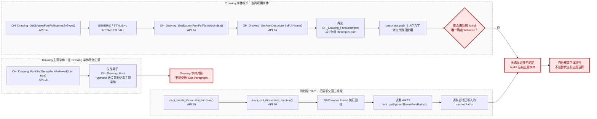
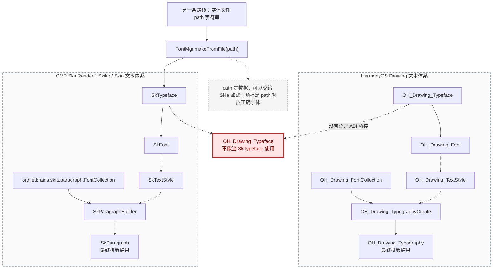
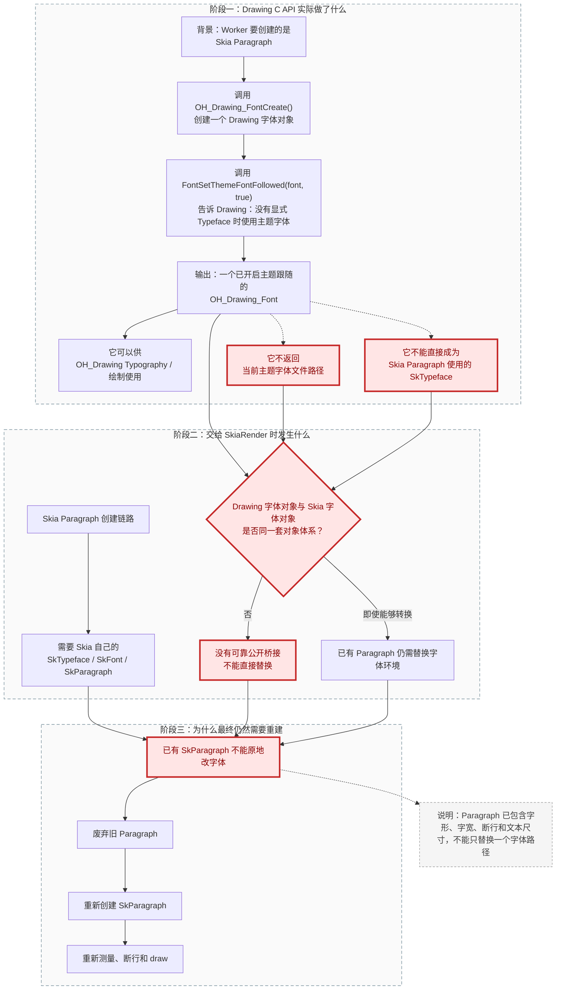
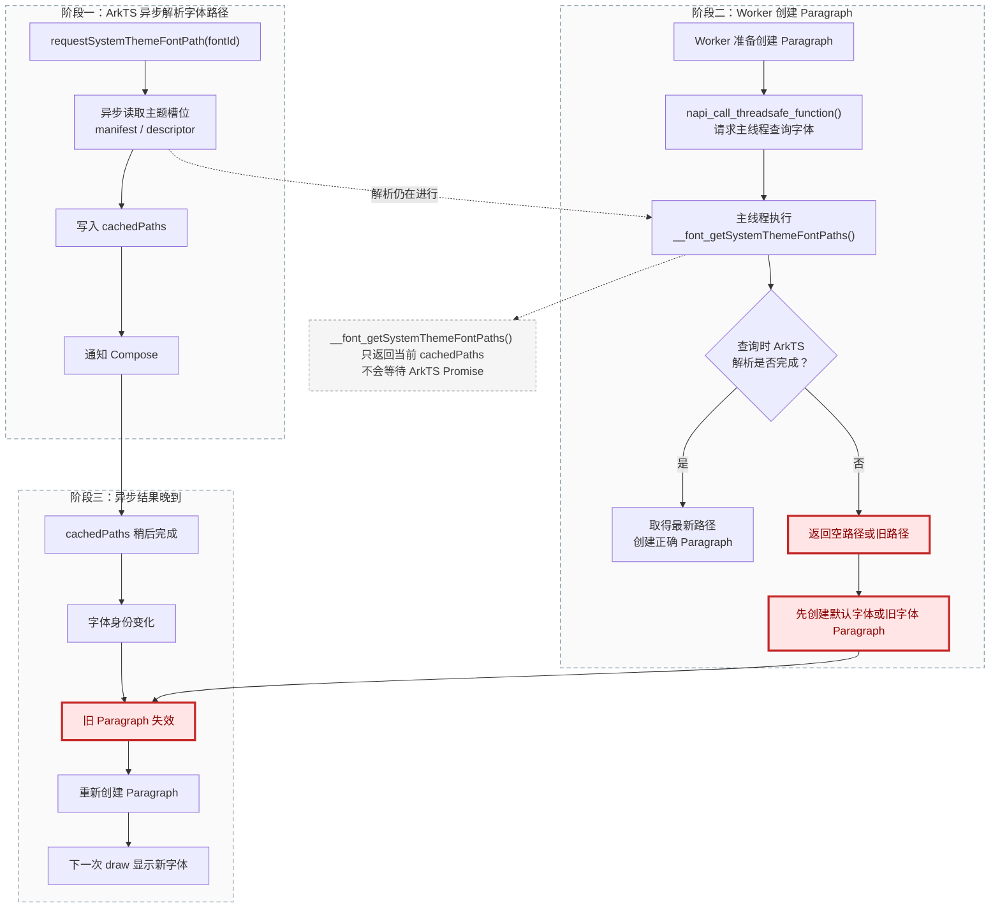
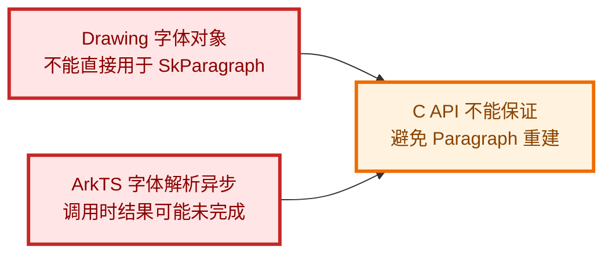

# C API 能否让 Worker 避免 Paragraph 重建

> - 分析日期：2026-11-16
> - 分析对象：CMP OHOS SkiaRender
> - 参考提交：`cd98e8a3c532fb783e8b6ca796e0c2e73ad547a4`
> - 红色节点：方案的阻塞点

## 0. 明确回答

想在 Worker 中不经过 NAPI，直接调用一个公开 C API，取得“当前 ArkUI 已选主题字体的文件路径”：

> 基于 DevEco Studio 6.0.0 当前 SDK 头文件和 CMP 源码，没有找到这样的公开 C API。

已核对的相关能力只有：

| 已有 API | 实际结果 | 是否满足需求 |
| --- | --- | --- |
| `napi_create_threadsafe_function()` / `napi_call_threadsafe_function()` | 把请求异步投递到 NAPI owner thread | 否，仍然是 NAPI 路径 |
| `OH_Drawing_GetSystemFontFullNamesByType()` | 枚举可用字体 fullName | 否，不能说明当前主题选中了哪项 |
| `OH_Drawing_GetFontDescriptorByFullName()` | 从指定 fullName 取得 `descriptor.path` | 部分满足；前提是已经知道正确 fullName |
| `OH_Drawing_FontSetThemeFontFollowed()` | 让 `OH_Drawing_Font` 内部跟随主题字体 | 否，不返回字体路径 |

SDK 中当前主题选择对应的 `fontId` 位于 ArkTS 的 `Configuration.fontId`；Native 头文件中没有对应的直接 getter，也没有 `fontId → 当前主题字体路径` 的公开 C API。

## 1. 结论

Worker 通过 C API 获取字体，不能保证避免 Paragraph 重建，主要有两个阻塞点：

1. Drawing 字体对象和 Skia Paragraph 使用的字体对象不是同一套对象。
2. ArkTS 字体路径解析是异步的，Worker 调用 C API 时解析不一定已经完成。

需要特别澄清：

- `OH_Drawing_GetFontDescriptorByFullName()` 返回的 `descriptor.path` 可以使用。
- 当前项目也可以取得字体 fullName，ArkTS 已经在使用 `getSystemFontFullNamesByType()`。
- 真正的问题是：`fontId` 不能直接唯一映射到当前主题字体的 fullName；枚举得到的字体列表也不等于“当前用户选择的字体”。

当前 ArkTS Resolver 已经同时使用：

```text
text.getSystemFontFullNamesByType(GENERIC / STYLISH)
  → 取得 fullName
text.getFontDescriptorByFullName(fullName, fontType)
  → 取得 descriptor.path
```

所以不是“项目拿不到 fullName”，也不是“descriptor.path 不能用”。

## 2. 具体可用的 C API



| 可用 API | 能做什么 | 不能解决什么 |
| --- | --- | --- |
| `napi_create_threadsafe_function()` / `napi_call_threadsafe_function()` | Worker 可把查询投递到 NAPI owner thread | 不会同步等待 ArkTS Promise，也不会直接读取 `napi_value` |
| `OH_Drawing_GetSystemFontFullNamesByType()` / `OH_Drawing_GetSystemFontFullNameByIndex()` | 可以获得可用字体的 fullName | 字体列表不等于当前主题选择 |
| `OH_Drawing_GetFontDescriptorByFullName()` | 可以从正确 fullName 取得 `descriptor.path`，该 path 可以使用 | 输入必须是 fullName，不能直接传当前 `fontId` |
| `OH_Drawing_FontSetThemeFontFollowed()` | 让 `OH_Drawing_Font` 在未设置 Typeface 时跟随主题字体 | 只作用于 Drawing 字体，不能更新 Skia Paragraph |

这三个问题需要分开：

```text
系统有哪些字体？
  → getSystemFontFullNamesByType()

指定某个 fullName，对应哪个文件 path？
  → getFontDescriptorByFullName(fullName, type)

当前 ArkUI 主题究竟选中了哪一个 fullName？
  → 字体枚举和 descriptor 查询都不能回答
```

如果已经知道“当前主题字体”的 fullName，那么 `OH_Drawing_GetFontDescriptorByFullName()` 可以取得它的 path。问题在于 fullName 列表没有当前选中标记，当前 `fontId` 也不能直接转换成 fullName。

当前能确定的信息可以分成三层：

| 信息 | 当前能否直接取得 | 来源 |
| --- | --- | --- |
| 当前主题选择的 `fontId` | 能 | ArkTS `Configuration.fontId` |
| 当前主题字体文件 path | 能 | 当前激活主题目录、`flag`、`manifest.json` |
| 系统可用字体的 fullName 列表 | 能 | `getSystemFontFullNamesByType()` 或 Drawing 枚举 API |
| “当前主题字体”对应的唯一 fullName | 没有直接映射 API | 需要用主题 path 反查，或直接使用已经取得的 path |

因此并不是“只能知道 fontId”。当前项目已经能取得当前主题文件 path；只是 system 没有提供一个这样的 API：

```text
Configuration.fontId
  → 当前主题字体 fullName
```

一旦通过激活主题目录和 manifest 取得了 path，Skia 就可以直接加载该 path，不再需要先转换出 fullName。

## 3. Drawing 对象体系与 Skia 对象体系

### 3.1 两套对象怎样对应

| 作用 | HarmonyOS Drawing C API | CMP SkiaRender |
| --- | --- | --- |
| 字体管理器 | `OH_Drawing_FontMgr` | `org.jetbrains.skia.FontMgr` |
| 字体集合 | `OH_Drawing_FontCollection` | `org.jetbrains.skia.paragraph.FontCollection` |
| 字形资源 | `OH_Drawing_Typeface` | `org.jetbrains.skia.Typeface`（SkTypeface） |
| 字体实例 | `OH_Drawing_Font` | `org.jetbrains.skia.Font`（SkFont） |
| 文本样式 | `OH_Drawing_TextStyle` | `org.jetbrains.skia.paragraph.TextStyle` |
| 文本构建器 | `OH_Drawing_TypographyCreate` | `org.jetbrains.skia.paragraph.ParagraphBuilder` |
| 最终排版结果 | `OH_Drawing_Typography` | `org.jetbrains.skia.paragraph.Paragraph`（SkParagraph） |

两边概念相似，但公开类型、ABI 和生命周期不同。即使 Drawing 内部实现也使用 Skia，`OH_Drawing_*` 对外仍是不透明对象，不能把它的指针当成 `SkTypeface*` 或 `SkParagraph*` 使用。

Drawing 对象由 `OH_Drawing_*Create()` 创建，并通过对应的 `OH_Drawing_*Destroy()` 释放；Skiko 的 `Typeface`、`Font`、`Paragraph` 则是 Kotlin 侧对 Skia native 对象的封装，由 Skiko 的引用计数和 finalizer 管理。这两套对象不能共享同一个可公开交换的指针所有权。

### 3.2 两套文本对象体系



这两条路线的区别是：

```text
传递对象：OH_Drawing_Typeface → SkTypeface
结果：没有公开可靠转换，不能直接使用

传递数据：descriptor.path → FontMgr.makeFromFile(path)
结果：可以使用，但必须先保证 path 是当前主题对应的正确文件
```

### 3.3 为什么 Drawing 主题字体不能直接进入 Skia Paragraph



即使 Worker 拿到了 Drawing 主题字体，它也不是当前 Skiko Paragraph 直接使用的 `SkTypeface`。已有 Paragraph 不能原地换字体，仍然要创建新的 SkParagraph。

阶段一不是在“解析主题字体路径”。它只是创建一个 Drawing 字体对象，再设置一个“跟随主题”的开关。这个 API 不返回路径，输出的 `OH_Drawing_Font` 也只归 Drawing 文本系统使用；Skia Paragraph 无法直接拿它替换已有的 `SkTypeface`。

另一条“fullName → descriptor.path”路线确实能取得可用的 path，但前提是已经知道正确的 fullName。字体枚举 API 不能把当前 `fontId` 直接映射成 ArkUI 当前选择的主题字体。

## 4. 阻塞点二：C API 查询时 ArkTS 不一定解析完成



Worker 调用 C API 只能看到“调用这一刻已写入的字体结果”。如果 ArkTS 还在读取主题目录、manifest 或 descriptor，Worker 仍会先创建默认字体或旧字体 Paragraph；等路径完成后，必须重建。

## 5. 两条阻塞点的共同结论



一句话总结：

> C API 可以改变字体信息的获取方式，但不能改变 Skia Paragraph 的对象模型，也不能保证调用时 ArkTS 已经解析完成。

## 6. 关键源码

| 作用 | 源码 |
| --- | --- |
| Worker 创建 Skia Paragraph | `compose/foundation/foundation/src/commonMain/kotlin/androidx/compose/foundation/text/modifiers/TextPrefetchSupport.kt` |
| Skiko Paragraph 创建 | `compose/ui/ui-text/src/skikoMain/kotlin/androidx/compose/ui/text/platform/ParagraphBuilder.skiko.kt` |
| Skia 字体集合注入 ParagraphBuilder | `compose/ui/ui-text/src/skikoMain/kotlin/androidx/compose/ui/text/font/SkiaFontLoader.skiko.kt` |
| ArkTS 异步字体解析和 `cachedPaths` | `compose/ui/ui-arkui/src/ohosArm64Main/cpp/compose/src/main/ets/compose/font/OhosSystemThemeFontResolver.ets` |
| Drawing 字体对象 | SDK `native_drawing/drawing_font.h`、`drawing_font_mgr.h` |
| Drawing 字体枚举和 descriptor | SDK `native_drawing/drawing_text_font_descriptor.h` |
| 跨线程 NAPI | SDK `napi/native_api.h` |
| Skia 对象定义 | `third_party/skiko/skiko/skiko/src/commonMain/kotlin/org/jetbrains/skia/Typeface.kt`、`FontMgr.kt`、`paragraph/ParagraphBuilder.kt`、`paragraph/Paragraph.kt` |

