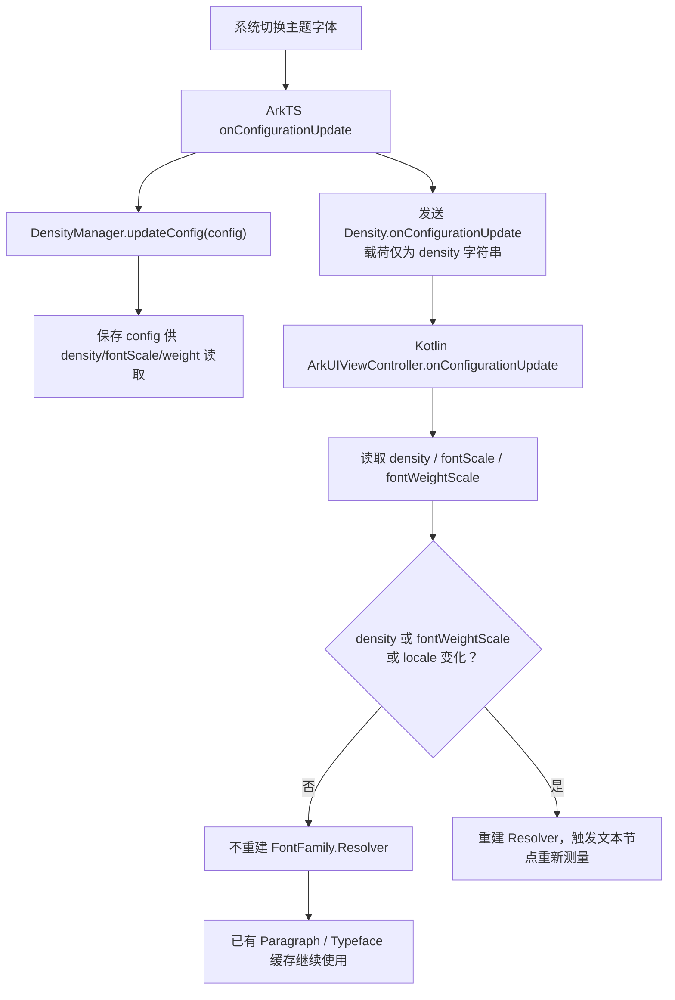

# CMP 不跟随系统字体问题分析报告

| 项目 | 内容 |
| --- | --- |
| 分析日期 | 2026-10-29 |
| 问题类型 | OHOS 系统主题字体兼容性 / Compose 文本字体解析 / 运行时配置更新 |
| 当前结论 | 已定位到两个直接原因，并识别出缓存与字体度量两个后续风险 |
| 结论置信度 | 初始字体不跟随：高；运行中切换无效：高；度量偏差风险：中，需设备原型确认 |
| 本次边界 | 只读源码、官方接口和任务材料分析；未修改产品源码，未构建，未安装，未做真机验证 |

> 2026-10-29 真机补充：P0 原型随后已完成 Fusion 冷启动验证。默认/Material3 文本确实跟随系统主题字体，但显式 `SystemFont("HarmonyOS Sans")` 也被替换，完整验收为部分通过。详见 `CMP系统主题字体-P0验证报告.md`。以下第 1～14 节保留初始静态分析内容，其“未做真机验证”的边界仅适用于当时版本。

> 2026-10-29 P1 补充：Fusion Renderer 下，冷启动跟随与后台切换字体后的热更新均已通过真机验证；系统字体从 `h0011` 切到 `22200001` 时，CMP 保持同一 PID，并记录 `CMP_FONT pageShow themeIdentity previous=h0011 current=22200001 generation=1`。显式 `SystemFont("HarmonyOS Sans")` 固定语义仍未解决，SkiaRender 未验证。详见 `CMP系统主题字体-P1热切换验证报告.md`。

> 2026-10-30 P2 补充：显式 `SystemFont("HarmonyOS Sans")` 已修复并通过 Fusion 真机 A/B；最终设备重新安装 Fusion HAP，运行日志为 `backendId=1`。SkiaRender 已用真实 `backendId=0` 验证，当前实现不跟随系统主题字体，本报告不能把 Fusion 结论外推到 Skia。详见 `CMP系统主题字体-P2显式字体与运行修复报告.md`。

> 2026-10-30 P3 补充：SkiaRender 已完成修复并通过真机验收。`backendId=0` 下默认字体可在 `HarmonyOS_Sans_SC.ttf` 与自定义 `ShuS-SC.ttf` 之间冷启动及同进程双向切换，日志均出现 `resolved=true`。原任务范围明确包含 Skia，P2 的“Skia 未支持”仅为中间历史边界，不再是最终结论。详见 `CMP系统主题字体-P3-SkiaRender修复与真机验证报告.md`。

## 1. 结论摘要

这不是单次重绘遗漏，而是三个问题叠加：

1. **字体选择语义被覆盖。** Compose 的默认字体最终被解析成固定别名 `HarmonyOS Sans` / `Sans-serif`，随后通过 `fontFamilies` 和 `typeface` 显式传给 OHRender。OHOS 规定，一旦调用 `OH_Drawing_SetTextStyleFontFamilies` 指定字体族，就会优先使用指定字体，而不是系统主题字体。
2. **系统字体变化没有形成新的 Compose 字体版本。** ArkTS 配置回调目前主要向 Kotlin 同步 density；`fontId` 没有被保存、比较或转发。Kotlin 端重建 `FontFamily.Resolver` 的条件只有 density、fontScale、fontWeightScale 和 locale，不包含字体族变化。
3. **现有缓存键没有字体环境。** 即使后续只移除固定 family，`GlobalTypefaceCache`、OHRender `FontCollection` 的 typeface 缓存以及部分文字样式缓存仍可能返回切换前的字体。必须让字体切换同时产生可传播、可失效的版本。

因此，修复不能只做“配置变化后 invalidate 一次”。正确的完成条件是：

> 检测 `fontId` 变化 → 形成新的字体 generation → 建立 Theme 字体 Resolver → 使用 OHOS 全局主题 FontCollection 且不设置固定 family/typeface → 重新测量和绘制 → 旧缓存及旧异步结果不可进入当前页面。

对于 Fusion Renderer，现有底层已经借用 `OH_Drawing_GetFontCollectionGlobalInstance()`，具备跟随主题字体的基础能力。对于 SkiaRender，当前字体管理器仍从系统 fontconfig 构建，不能因为 Fusion 方案成立就自动推断它也能跟随主题字体；SkiaRender 需要单独评估。

## 2. 问题现象与对照

已知现象：

- 在系统主题设置中将默认的鸿蒙字体切换为“仿宋”等字体后，ArkUI/WebView 文本发生变化。
- Compose 绘制的文本继续显示原有字体。
- 用户尝试在页面运行中切换，Compose 页面仍不变化。
- 问题诉求集中在字体族，字号缩放不在本次结论范围内。

WebView 的变化只证明系统字体已经切换、应用能够看到配置变化，不证明其内部实现与 Compose 相同。Compose 自绘文本需要自己完成字体选择、测量、缓存失效和绘制更新。

## 3. 根因一：默认字体被转换成显式固定字体

### 3.1 调用链

```mermaid
flowchart LR
    A["Material3 Text<br/>默认无 fontFamily"] --> B["textStyle.fontFamily = null"]
    B --> C["ComputedStyle.toSkTextStyle<br/>回退为 FontFamily.Default"]
    C --> D["FontCache.ensureRegistered(Default)"]
    D --> E["FontFamily.SansSerif.aliases"]
    E --> F["HarmonyOS Sans, Sans-serif"]
    F --> G["FontCollection.findTypefaces"]
    G --> H["具体 SkTypeface"]
    H --> I["SkTextStyle.fontFamilies + typeface"]
    I --> J["OH_Drawing_SetTextStyleFontFamilies"]
    J --> K["指定 family 优先<br/>主题字体被覆盖"]
```



源码链路如下：

1. 默认文本没有显式 family 时，`ComputedStyle.toSkTextStyle()` 使用 `fontFamily ?: FontFamily.Default`。
2. `FontCache.ensureRegistered(DefaultFontFamily)` 将 `Default` 映射为 `FontFamily.SansSerif.aliases`。
3. OHOS 的 `SansSerif` 映射是固定的：

   ```text
   ["HarmonyOS Sans", "Sans-serif"]
   ```

4. `FontCache.loadPlatformTypes()` 查询具体 `SkTypeface`，并将解析结果写入 `FontLoadResult`。
5. `ComputedStyle.toSkTextStyle()` 同时设置：

   ```kotlin
   res.fontFamilies = resolved.aliases.toTypedArray()
   res.typeface = resolved.typeface
   ```

6. OHRender 在 `pushReplayStyle()` 中将该样式同步到 OH Typography。只要样式带有显式 family，就会调用 `OH_Drawing_SetTextStyleFontFamilies`。
7. 当 family 仍是内部默认 `sans-serif` 且 typeface 带具体 family 名称时，OHRender 还会从 typeface 反填具体 family，进一步固定字体。

### 3.2 与 OHOS 官方规则冲突

OHOS 官方“使用主题字体（C/C++）”文档明确要求：

- 主题字体必须通过 `OH_Drawing_GetFontCollectionGlobalInstance()` 获取全局 FontCollection。
- 使用主题字体时，**不要调用** `OH_Drawing_SetTextStyleFontFamilies()` 指定字体族。
- 一旦指定字体族，行为会变为优先使用指定字体，而不是主题字体。
- 字体变化后，应用必须自行识别 `fontId` 变化并刷新排版；否则通常要重启应用才生效。

当前 Compose 的行为正好落入被官方文档明确排除的路径：底层拿到了全局 FontCollection，但它仍向 Typography 显式提供了具体字体族。

### 3.3 影响范围

直接受影响的是：

- 未设置 `fontFamily` 的 `BasicText`。
- Material3 的默认排版。Material3 的 `Brand` 和 `Plain` token 都使用 `FontFamily.SansSerif`。
- 显式使用 `FontFamily.Default` 或 `FontFamily.SansSerif` 的文本。
- `AnnotatedString` 中未覆盖字体族的默认范围。
- TextField、选择、光标、行布局等所有从同一文本排版栈派生的内容。

不应自动跟随主题字体的范围：

- 业务显式指定的 `SystemFont("某个字体")`。
- 资源字体、`LoadedFontFamily`、IconFont。
- `Monospace`。
- `Serif`、`Cursive` 是否跟随，应按产品语义单独评审；本次最小方案不应顺带改变。

## 4. 根因二：运行中字体变化没有进入 Compose 字体版本

### 4.1 当前配置链路



源码事实：

- `DensityManager` 接收 ArkTS `Configuration`，但只从中读取 `fontSizeScale`、`fontWeightScale`、`colorMode` 等字段，没有读取 `fontId`。
- `ComposeMessengerServices.onConfigurationUpdate()` 向 Kotlin 发送的消息仍只有 density 字符串。
- Kotlin `applyConfigurationUpdateVisuals()` 分别检测 density、fontWeightScale、locale 和深浅色主题，没有 `fontThemeChanged`。
- 只有 `densityChanged || fontWeightScaleChanged || localeChanged` 时才替换 `fontFamilyResolver`。
- `LocalFontFamilyResolver` 只会在 Resolver 对象变化时让文本节点感知布局参数变化。

因此，用户在运行中切换字体时，ArkTS 可以请求一轮重绘，但没有新的字体 generation，也没有重建排版环境。重绘旧 Paragraph 仍然得到旧字形。

### 4.2 为什么“重启应用”也不一定解决

根因一在冷启动时同样成立。即便应用重新启动后重新读取了当前系统主题，Compose 仍会把 Default/`SansSerif` 解析为固定的 `HarmonyOS Sans`。因此：

- 首次启动不跟随字体，主要由根因一解释。
- 运行中切换不立即变化，主要由根因二解释。
- 二者不是同一个补丁能够分别替代的问题。

## 5. 根因三：缓存没有字体环境身份

这是实施时必须同时处理的稳定性问题，也是“只改 family”仍可能继续显示旧字体的原因。以下缓存当前会复用跨字体环境结果：

| 缓存 | 当前键 | 风险 |
| --- | --- | --- |
| `GlobalTypefaceCache` | aliases、weight、slant | 没有 `fontId` 或 generation；旧的固定 typeface 可继续命中 |
| OHRender `FontCollection::fTypefaces` | familyNames、fontStyle | 主题变化后仍可能返回旧 family 的 typeface |
| `skTextStylesCache` | `ComputedStyle` | 没有 Resolver / generation 身份，至少需要确认是否可能跨环境复用 |
| `SkiaParagraphIntrinsicsCache` | `fontFamilyResolver` 对象等 | Resolver 重建后可隔离，但不会主动淘汰旧环境条目 |
| `GlobalMultiParagraphCache` | `fontFamilyResolver` 对象等 | 依赖 Resolver 必须真正变化；若 Resolver 不变则继续命中旧布局 |
| 文本预取 | 当前使用 Resolver hash 等 | Resolver 变化通常可隔离，但仍需保证旧异步结果不发布 |

关键不是简单调用一次 `invalidateDraw()`，而是：

- 主题字体的物理 typeface 选择结果不能与固定 family 共用同一条无版本缓存。
- 字体变化必须产生明显的环境版本。
- 新版本开始后，旧预取和旧测量结果不能更新当前缓存。

现有 `invalidatePlatformCaches()` 只清 locale、density、theme 等缓存，不清系统字体 typeface 选择结果；它不能承担字体族切换的失效职责。

## 6. 字体度量风险：字形切换不等于排版几何正确

当前 Compose 文本几何还会读取 Skia 侧 `defaultFont.metrics`：

- `ParagraphBuilder.defaultFont` 构造 `SkFont(loadResult?.typeface, ...)`。
- 空文本行指标直接使用该字体的 metrics。
- `SkiaParagraph.receiveLineMetrics()` 使用该 metrics 修正首行 ascent、末行 descent。
- 光标和 `baselineShift` 也会读取默认字体或实际文本度量。

若只让 OH Typography 使用主题字体，但 Compose 侧仍用固定 HarmonyOS Sans 的 metrics 做空行、trim、baselineShift 或光标修正，可能出现：

- 换行和实际字形使用新字体，但行高、首末行留白仍按旧字体计算。
- 固定 `lineHeight + trim` 下上下裁切不对称。
- 上下标位置、空行高度、输入框光标高度出现偏差。

这部分不是“字体不变化”的直接根因，但属于正式支持主题字体前必须验证的排版风险。若设备原型显示相关场景没有偏差，也不能据此删除保护；应记录实测矩阵。

## 7. 后端适用性

| 后端 | 当前能力 | 结论 |
| --- | --- | --- |
| Fusion Renderer，API 14+ | OHRender 已通过全局 FontCollection 创建 Typography | 具备正式支持基础；主要缺口在 Compose 字体语义、事件、缓存和度量 |
| Fusion Renderer，API < 14 | 只能用共享 FontCollection，不包含主题字信息 | 应明确回退旧行为 |
| SkiaRender | 使用自带 Skia 字体管理器；当前 patch 从系统 fontconfig 构建字体集合 | 不能仅靠移除 family 获得主题字体支持，需要单独验证/实现 |

参考材料中的“Fusion 方案”可以覆盖 Fusion/RenderNode 路径，但不能直接作为 SkiaRender 的承诺。

当前样例工程的 `gradle.properties` 默认配置是 `rendererBackend=skia`，因此若用该 sample 验证，必须先确认实际构建命令和产物确实切到 `fusion-renderer` / `backendId=1`，否则结果不能用于判断 Fusion 修复。

## 8. 推荐修复方案

### 8.1 P0：最小原生与 Compose 原型

目标是以最小改动证明根因，不直接作为最终发布实现。

1. 在 Fusion/API 14+ 环境建立三组对照：

   | 组别 | FontCollection | TextStyle family/typeface | 预期 |
   | --- | --- | --- | --- |
   | A | 全局实例 | 不指定 family/typeface | 跟随系统主题字体 |
   | B | 全局实例 | 显式 `HarmonyOS Sans` | 固定 HarmonyOS Sans |
   | C | 共享实例 | 不指定 family/typeface | 不保证跟随主题，作为能力对照 |

2. 在 Compose 中给 Default/SansSerif 增加 Theme 意图，验证：

   - 冷启动时使用当前主题字体。
   - 运行中修改 `fontId` 后，重建 Resolver 并重新排版。
   - 不改变显式字体、资源字体和 Monospace。

3. 对空行、固定行高、trim、baselineShift、maxLines/省略和 TextField 光标做单独 FPS/几何检查。

### 8.2 P1：可发布的 Fusion 主题字体链路

推荐增加容器级 `systemFontPolicy`：

- `LegacyDefault`：保持旧行为，作为首个版本默认值。
- `FollowSystemTheme`：仅 Fusion/API 能力完整时启用。

主要改动职责：

| 层 | 建议改动 |
| --- | --- |
| ArkTS 配置桥 | 读取 `context.config.fontId`，在 environment / host 配置回调中去重并转发字体快照 |
| Kotlin 容器 | 保存字体 generation；字体变化时重建 Resolver，即使 density 不变 |
| ui-text 字体解析 | Default/SansSerif 产生 Theme 意图；不预热、不写入固定 HarmonyOS family |
| OHRender Typography | Theme 模式跳过 `OH_Drawing_SetTextStyleFontFamilies`，不把 typeface family 反填 |
| 缓存 | 缓存键加入字体环境 generation；切换时清理旧主题结果 |
| 后台/多窗口 | 后台只记录 pending，恢复时应用最新 generation；多个窗口各更新自己的 Resolver |
| 诊断 | 记录 `fontId changed → generation → resolver → relayout → draw`，不可把“收到事件”当成“已生效” |

### 8.3 P2：完整排版与发布

正式开启前补齐：

- 主题字体的基础度量来源。优先直接消费实际 Typography 行指标；对 Compose 额外的空行/trim/baselineShift 修正，建立与主题字体一致的 metric 接口。
- API 14～19 与 API 20+ 的度量能力矩阵。
- 旧异步文本预取、MultiParagraph、Intrinsics 和 typeface 缓存的 generation 隔离。
- 生命周期、多窗口、后台恢复、资源释放和能力回退。
- 关闭开关后与旧基线一致。

## 9. 不建议的方案

| 方案 | 不能作为最终修复的原因 |
| --- | --- |
| 只在字体变化时调用一次重绘 | 不改变字体解析和已有 Paragraph，仍会绘制旧字形 |
| 把 `HarmonyOS Sans` 字符串硬改为某个当前主题字体名 | 只支持一次实验，丢失任意主题字体语义，且切换后仍会过期 |
| 删除业务层所有 `fontFamily` | 会破坏显式字体、IconFont 和等宽字体语义；也无法可靠覆盖 Material3 和富文本 |
| 每帧读取系统字体 | 开销高，且不能解决错误 family 和旧缓存 |
| 只使用 `OH_Drawing_TypefaceCreateDefault()` | 默认轮廓对象不等于主题字体选择协议；显式 typeface 仍可能覆盖主题文字体 |
| 把 Fusion 方案直接复制到 SkiaRender | 两条后端使用不同字体集来源，不能据 Fusion 结果承诺 SkiaRender |

## 10. 验收标准

### 10.1 基础功能

- 系统已选主题字体后冷启动，Material3 `Text` 和 `BasicText` 从首帧使用主题字体。
- 应用运行中切换主题字体并返回页面，已有可见文本完成重新测量和绘制。
- 切回默认字体后同样生效，不因空字符串或缓存命中漏掉更新。
- `FontFamily.Default`、`SansSerif` 跟随；显式字体、资源字体、IconFont 和 Monospace 保持。

### 10.2 复杂文本与交互

- SimpleText、AnnotatedString 混合 Span、Material3 文本均生效。
- 中英文、emoji、粗体、斜体、maxLines、省略和内联内容正常。
- 固定 lineHeight、trim、baselineShift、空行和 TextField 光标/选区没有裁切或偏移。
- 后台页面恢复后使用最新字体，不持续触发后台渲染。
- 多窗口分别更新；关闭或重建的页面不再接收字体回调。

### 10.3 回退与可观测性

- API 低于 14、全局 FontCollection 不可用、桥接能力不匹配时进入明确的 LegacyFallback。
- 回退后字体选择、布局和缓存均回到一致的旧环境，不混用新旧环境。
- 日志能关联 fontId 变化、generation、容器应用和一次有效排版。
- 缓存有界，重复切换不会不断累积旧字体结果。

## 11. 验证边界与残余风险

本报告基于当前工作区源码和官方接口静态分析：

| 仓库 / 分支 | 当前提交 |
| --- | --- |
| compose-multiplatform-core / develop-1.9.2-OH | `90f0034e8ce34d43ab2ed3f248bb05983e95a7c2` |
| third_party/fusion-render / develop | `cc7810c5253f1dbe8bd5aed4bbd997a37c00b6d9` |
| third_party/skiko/skiko / develop-0.9.22.2-OH | `19bdc274b0d07ff531322b8effe5ed5639a1dcbc` |

未执行：

- Kotlin / ArkTS / C++ 编译。
- Skiko、Fusion 或 HAP 打包。
- HAP / `libkn.so` 哈希与运行时产物匹配。
- 设备安装、字体切换、hilog、trace 或截图对照。

因此，本报告可以高置信度说明“为什么当前代码不会跟随主题字体”，但不能替代对目标应用使用的 HAP、KLIB、`libkn.so`、设备 API 和实际后端的运行时确认。

## 12. 建议的后续决策

1. 先确认目标应用实际使用 Fusion 还是 SkiaRender，并记录 API 版本。
2. 若目标是 Fusion，先执行本文第 8.1 节 P0 原型，验证官方规定的无 family 路径。
3. P0 通过后，按 `FollowSystemTheme` 开关实现事件、generation、Theme 字体选择、OHRender 主题模式和缓存隔离。
4. 将字体度量、富文本、输入框、多窗口和后台恢复作为正式开启门槛，不以冷启动单张截图作为完成证据。

## 13. 源码与官方文档证据索引

### 13.1 当前源码

| 编号 | 位置 | 支持的事实 |
| --- | --- | --- |
| S01 | `compose-multiplatform-core/compose/ui/ui-text/src/skikoMain/kotlin/androidx/compose/ui/text/platform/PlatformFont.skiko.kt:344` | `loadPlatformTypes` 返回同一套 alias/typeface 结果 |
| S02 | 同上 `:392`、`:481` | Default 映射到 SansSerif；OHOS SansSerif 固定为 HarmonyOS Sans / Sans-serif |
| S03 | `.../ParagraphBuilder.skiko.kt:189` | Default 文本最终以显式 `fontFamilies` 和 `typeface` 写入 SkTextStyle |
| S04 | `compose-multiplatform-core/compose/material3/material3/src/commonMain/kotlin/androidx/compose/material3/tokens/TypefaceTokens.kt:24` | Material3 Brand / Plain 使用 SansSerif |
| S05 | `compose-multiplatform-core/compose/ui/ui-arkui/src/ohosArm64Main/cpp/compose/src/main/ets/compose/density/DensityManager.ets:86` | ArkTS 接收 Configuration，但没有读取 fontId |
| S06 | `compose-multiplatform-core/compose/ui/ui-arkui/src/ohosArm64Main/cpp/compose/src/main/ets/compose/ComposeMessengerServices.ets:148` | 配置更新只发送 density 字符串并请求刷新 |
| S07 | `compose-multiplatform-core/compose/ui/ui/src/ohosArm64Main/kotlin/androidx/compose/ui/window/ComposeArkUIViewContainer.kt:460` | Resolver 重建条件不含 fontId / 字体族变化 |
| S08 | `compose-multiplatform-core/compose/ui/ui/src/ohosArm64Main/kotlin/androidx/compose/ui/text/platform/OhosNapiTextPlatformProvider.kt:40` | 平台缓存清理主要覆盖 locale/density/theme，不处理字体族版本 |
| S09 | `.../PlatformFont.skiko.kt:516` | `GlobalTypefaceCache` 键只有 aliases、weight、slant |
| S10 | `.../SkiaParagraphIntrinsics.skiko.kt:34` | Paragraph Intrinsics 缓存键依赖 Resolver 对象 |
| S11 | `compose-multiplatform-core/compose/foundation/foundation/src/commonMain/kotlin/androidx/compose/foundation/text/modifiers/MultiParagraphLayoutCache.kt:386` | 文字布局缓存键依赖 Resolver 对象 |
| S12 | `compose-multiplatform-core/compose/foundation/foundation/src/commonMain/kotlin/androidx/compose/foundation/text/modifiers/TextStringSimpleNode.kt:204` | Resolver 真正变化时文本节点才会触发布局失效 |
| S13 | `compose-multiplatform-core/compose/ui/ui-text/src/skikoMain/kotlin/androidx/compose/ui/text/platform/ParagraphBuilder.skiko.kt:705`、`:711` | 空行指标来自默认 SkFont metrics |
| S14 | `compose-multiplatform-core/compose/ui/ui-text/src/skikoMain/kotlin/androidx/compose/ui/text/SkiaParagraph.skiko.kt:331` | 首末行 trim 使用默认字体 metrics |

### 13.2 OHRender / Skiko

| 编号 | 位置 | 支持的事实 |
| --- | --- | --- |
| N01 | `third_party/fusion-render/OHRender/modules/skparagraph/include/FontCollection.h:84` | Fusion 使用 OH_Drawing_GetFontCollectionGlobalInstance 并禁止释放 |
| N02 | `third_party/fusion-render/OHRender/modules/skparagraph/src/ParagraphBuilderImpl.cpp:319` | 显式 family 会调用 OH_Drawing_SetTextStyleFontFamilies；内部默认 family 还可能被 typeface 反填 |
| N03 | `third_party/fusion-render/OHRender/modules/skparagraph/include/TextStyle.h:757` | family 被同步为 OH 文本样式 |
| N04 | `third_party/fusion-render/OHRender/modules/skparagraph/src/FontCollection.cpp:118` | typeface 缓存键缺少字体环境版本 |
| N05 | `third_party/fusion-render/OHRender/src/ports/SkFontMgr_ohos.cpp:171` | Native 注释明确 familyName > 主题字体 > locale > fallback |
| N06 | `third_party/fusion-render/OHRender/include/oh/OHDrawingAPI.h:436` | API 14 缺失时回退共享 FontCollection，不能保证主题字体 |
| N07 | `third_party/skiko/skiko/skia/patches/skia.patch:16018` | SkiaRender 的字体管理器从 OHOS fontConfig 构建，不等同于主题全局 FontCollection |

### 13.3 官方文档

| 编号 | 资料 | 支持的事实 |
| --- | --- | --- |
| W01 | [使用主题字体（C/C++）](https://github.com/openharmony/docs/blob/master/zh-cn/application-dev/graphics/theme-font-c.md) | 必须用全局 FontCollection；不要指定 family；接收 fontId 后主动刷新排版 |
| W02 | [Configuration](https://github.com/openharmony/docs/blob/master/zh-cn/application-dev/reference/apis-ability-kit/js-apis-app-ability-configuration.md) | `fontId` 从 API 14 提供，字段可选 |
| W03 | [drawing_font_collection.h](https://github.com/openharmony/docs/blob/master/zh-cn/application-dev/reference/apis-arkgraphics2d/capi-drawing-font-collection-h.md) | 全局 FontCollection 可感知主题字信息，API 14 起提供且禁止释放 |
| W04 | [drawing_text_typography.h](https://github.com/openharmony/docs/blob/master/zh-cn/application-dev/reference/apis-arkgraphics2d/capi-drawing-text-typography-h.md) | 指定 family 的 Typography 接口和文本样式接口 |
| W05 | [drawing_typeface.h](https://github.com/openharmony/docs/blob/master/zh-cn/application-dev/reference/apis-arkgraphics2d/capi-drawing-typeface-h.md) | `OH_Drawing_TypefaceCreateDefault` 只是创建默认字形对象，不等于主题字体选择策略 |

## 14. 最终判断

该问题不是单个渲染函数遗漏，而是 **Compose 字体语义层把“跟随系统”提前物化成了固定字体**，同时 **配置更新层没有表达字体 identity 的变化**。只改 OHOS Native 绘制代码或只做重绘都不能闭环。

最小可证明修复点是让 Fusion 的 Default/SansSerif 文本在 OH Typography 上不设置固定 family/typeface，并在 `fontId` 变化后建立新的排版环境。可发布修复还需要缓存 generation、度量一致性和明确回退能力。

---

参考材料：

`/Users/jinshuo/Desktop/Workspace/ohos-system-theme-font-20261023`

该材料用于交叉检查，不作为当前源码事实来源；本报告已针对当前工作区源码和 OHOS 官方文档重新核验。
