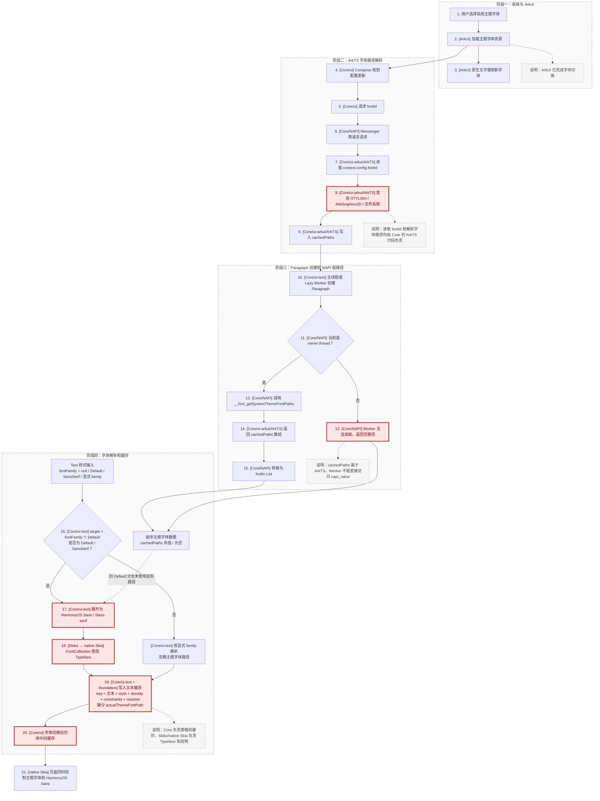
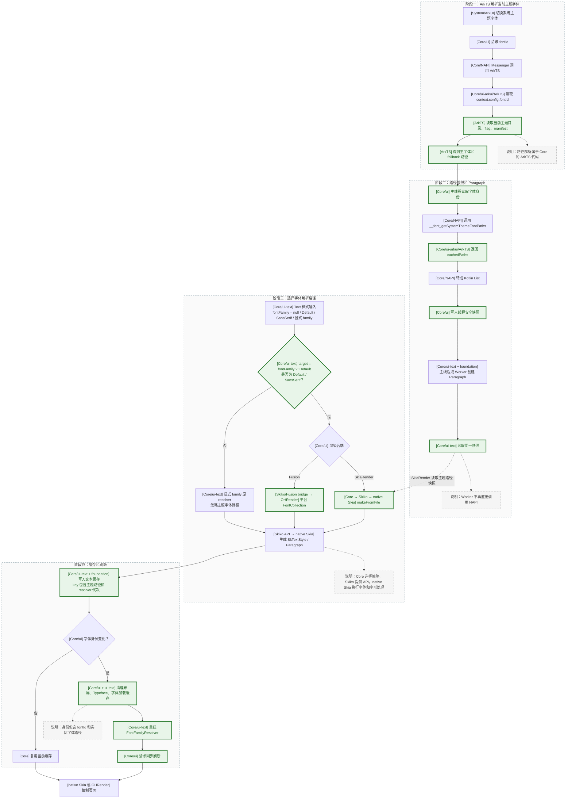

# CMP 不跟随系统字体：根因与修复

> - 状态：已修复并通过 SkiaRender 真机验证
> - 分支：`fix-font-switch`
> - 提交：`3ab5e5063ca9324238490003365fb9ba2a92d97f`
> - 文档更新：2026-11-10

> 当前工作树已经是修复后代码。“修复前逻辑”用于还原故障，“当前代码”表示最终实现。

## 1. 结论

这个问题不是 ArkUI 没有切换字体，而是 Compose 文本链路没有稳定使用 ArkUI 当前主题字体：

1. ArkTS 通过 `STYLISH` 猜测主题字体，结果可能为空或错误。
2. Lazy Worker 创建 Paragraph 时直接调用 NAPI，无法读取 ArkTS 数据。
3. Core 把 `FontFamily.Default` 展开为固定的 `HarmonyOS Sans / Sans-serif`。
4. Typeface、SkTextStyle 和 Paragraph 缓存没有完整纳入实际字体路径。

最终结果是主线程 Paragraph 和 Worker Paragraph 可能使用不同字体。

## 2. 各层职责

| 层/仓库 | 负责内容 | 关键位置 |
| --- | --- | --- |
| ArkUI / Core `ui-arkui` ArkTS | 读取 `Configuration.fontId`、主题目录、`manifest.json`、ArkGraphics2D descriptor，维护 `cachedPaths` | `compose-multiplatform-core/compose/ui/ui-arkui/.../ets` |
| Core NAPI/Messenger | Kotlin/Native 与 ArkTS 的函数调用和 `napi_value` 封送 | `compose/ui/ui/.../napi`、`ui-arkui/.../cpp` |
| Compose Core | 创建 Paragraph、决定 Compose family、维护文本缓存、检测字体身份、选择渲染后端 | `compose/ui/ui`、`ui-text`、`foundation/foundation` |
| Skiko | 提供 `FontMgr`、`Typeface`、`FontCollection`、`Canvas`、`Paragraph` 等 Kotlin/Native Skia API | `third_party/skiko/skiko/skiko` |
| native Skia | 字体文件解析、shaping、断行、文本布局和绘制 | Skiko 链接的原生 Skia |
| Fusion `OHRender` | RenderNode、OH_Drawing Canvas、文本和 ArkUI RenderNode 原生实现 | `third_party/fusion-render/OHRender` |

注意：`compose/ui/ui-text/src/skikoMain/` 属于 Core 的 Skiko 目标源集，不是 Skiko 仓库代码。

## 3. 修复前完整流程图

红色节点是故障阶段。第 4 章只分析红色节点，并使用图中原始编号。



步骤 16 的分支判断只依赖 `TextStyle.fontFamily`：

```text
TextStyle.fontFamily
  -> null / Default / SansSerif / 显式 family
```

前一步的 `cachedPaths` 只提供字体文件路径，不会推出 `FontFamily.Default`。步骤 16 先执行：

```kotlin
target = fontFamily ?: FontFamily.Default
```

再判断 `target` 是否为 `Default / SansSerif`。只有判断为是时，才进入主题字体处理；`cachedPaths` 是该分支后续使用的字体文件数据，不参与 `Default` 判断。

## 4. 问题分析与解决方案

### 4.0 修复后完整流程图

绿色节点表示本修复新增或修改的步骤；普通节点表示原有流程。



以下只分析修复前流程图中的红色故障步骤：8、13、17、18、19、20。

### 4.8 ArkTS 查询 `STYLISH`、ArkGraphics2D 和文件系统

**问题分析**

修复前优先把 `STYLISH` 当作当前主题字体来源：

```typescript
const stylishNames =
  await text.getSystemFontFullNamesByType(
    text.SystemFontType.STYLISH
  )

const fullNames = stylishNames.length > 0
  ? stylishNames
  : await text.getSystemFontFullNamesByType(
      text.SystemFontType.GENERIC
    )

let selectedPath = ''

for (const fullName of fullNames.slice(0, 16)) {
  const descriptor = await text.getFontDescriptorByFullName(
    fullName,
    stylishNames.length > 0
      ? text.SystemFontType.STYLISH
      : text.SystemFontType.GENERIC,
  )

  const path = descriptor.path ?? ''
  if (selectedPath.length === 0 && path.length > 0) {
    selectedPath = path
  }
}

cachedPath = selectedPath
```

失败原因：

- `STYLISH` 是 2-in-1 设备的风格字体分类。
- 它不代表全部用户安装字体。
- 它不代表当前选中的主题字体。
- 第一个可读 descriptor 不一定是用户选择的字体。
- descriptor 只表示字体存在，不表示当前激活。

异步请求开始时还会清空路径：

```typescript
cachedPath = ''
pendingFontId = fontId
resolveSystemThemeFontPath(fontId)
```

因此 Paragraph 在解析完成前读取时会得到空路径。

**解决方案**

优先读取 ArkUI 当前激活主题文件，`STYLISH` 只作为兼容 fallback：

```typescript
const THEME_FONT_ROOTS = [
  '/data/themes/a/app',
  '/data/themes/b/app',
]

function resolveThemeFontPathsFromRoot(
  root: string,
): Array<string> {
  const fontDirectory = `${root}/fonts`
  const paths: Array<string> = []

  if (
    !fs.accessSync(`${root}/flag`) ||
    !fs.accessSync(fontDirectory)
  ) {
    return []
  }

  const manifest = JSON.parse(
    fs.readTextSync(`${fontDirectory}/manifest.json`)
  )

  appendFontPath(paths, fontDirectory, manifest.ttfFileSrc ?? '')
  for (const source of manifest.ttfFileSrcExt ?? []) {
    appendFontPath(paths, fontDirectory, source)
  }

  return paths
}
```

解析入口：

```typescript
let activeThemeFontPaths: Array<string> = []

if (fontId !== DEFAULT_FONT_ID) {
  activeThemeFontPaths = resolveActiveThemeFontPaths()
}

const genericNames =
  fontId === DEFAULT_FONT_ID ||
  activeThemeFontPaths.length === 0
    ? await text.getSystemFontFullNamesByType(
        text.SystemFontType.GENERIC
      )
    : []

const stylishNames =
  fontId === DEFAULT_FONT_ID ||
  activeThemeFontPaths.length > 0
    ? []
    : await text.getSystemFontFullNamesByType(
        text.SystemFontType.STYLISH
      )
```

最终选择：

```typescript
if (
  fontId !== defaultFontId &&
  activePaths.length > 0
) {
  return activePaths
}

return normalizePaths(fallbackThemeFontPaths)
```

快速切换字体时丢弃过期结果：

```typescript
if (pendingFontId !== fontId) {
  return
}

cachedPaths = selectedPaths
resolvedFontId = fontId
pendingFontId = ''
```

### 4.13 Worker 无法读取 NAPI，返回空路径

**问题分析**

NAPI owner thread 是初始化 `napi_env` 的线程，当前 ArkUI 集成中通常是主线程。

```kotlin
if (!JsEnv.isOnNapiOwnerThread()) {
    return emptyList()
}
```

修复前 Worker 直接调用：

```kotlin
override fun getSystemThemeFontPath(): String {
    if (!JsEnv.isOnNapiOwnerThread()) return ""

    return callGlobalArrayFunction(
        "__font_getSystemThemeFontPaths"
    ).joinToString("\n")
}
```

结果：

```text
Worker
  -> isOnNapiOwnerThread() == false
  -> 返回空路径
  -> Skia 回退 HarmonyOS Sans
```

**解决方案**

主线程查询一次 ArkTS，并保存线程安全快照：

```kotlin
synchronized(lock) {
    cachedSystemThemeFontPath?.let { return it }
}

if (!JsEnv.isOnNapiOwnerThread()) return ""

val path =
    callGlobalArrayFunction("__font_getSystemThemeFontPaths")
        .joinToString("\n")

synchronized(lock) {
    cachedSystemThemeFontPath = path
}

return path
```

Worker 读取快照：

```kotlin
synchronized(lock) {
    cachedSystemThemeFontPath?.let { return it }
}
```

ArkTS 数组到 Kotlin 列表的转换：

```kotlin
val result = JsEnv.callFunction(target, func)
    ?: return emptyList()

return (0 until JsEnv.getArrayLength(result)).mapNotNull { index ->
    JsEnv.getElement(result, index)?.let {
        JsEnv.getValueStringUtf8(it)
    }?.takeIf { it.isNotBlank() }
}
```

### 4.17 Core 展开为固定 `HarmonyOS Sans / Sans-serif`

**问题分析**

Text 未指定 family 时，Core 使用 `FontFamily.Default`。修复前随后直接解析固定 family：

```kotlin
val targetFontFamily =
    fontFamily ?: FontFamily.Default

val resolved = fontFamilyResolver.resolve(
    targetFontFamily,
    fontWeight ?: FontWeight.Normal,
    fontStyle ?: FontStyle.Normal,
    fontSynthesis ?: FontSynthesis.None,
).value as FontLoadResult

res.fontFamilies = resolved.aliases.toTypedArray()
res.typeface = resolved.typeface
```

解析器将：

```kotlin
is DefaultFontFamily -> FontFamily.SansSerif.aliases
```

OHOS alias：

```kotlin
listOf("HarmonyOS Sans", "Sans-serif")
```

即使 ArkTS 已经取得主题文件路径，`Default` 仍被固定到这两个名称。

**解决方案**

保留 `Default` 的“跟随系统默认”语义，只让 `Default` 和 `SansSerif` 使用主题策略：

```kotlin
internal fun FontFamily.shouldUseSystemThemeFont(
    isOhos: Boolean,
): Boolean {
    if (!isOhos) return false

    return when (this) {
        is DefaultFontFamily -> true
        is GenericFontFamily ->
            name == FontFamily.SansSerif.name
        else -> false
    }
}
```

`ParagraphBuilder` 当前逻辑：

```kotlin
val useSystemThemeFont =
    targetFontFamily.shouldUseSystemThemeFont(
        isOhos = currentPlatform() == Platform.OHOS
    )

val useResolvedThemeTypeface =
    useSystemThemeFont &&
    !isFusionRenderBackendActive &&
    systemThemeFontPaths.isNotEmpty()

val resolved =
    if (useSystemThemeFont && !useResolvedThemeTypeface) {
        null
    } else {
        fontFamilyResolver.resolve(
            targetFontFamily,
            fontWeight ?: FontWeight.Normal,
            fontStyle ?: FontStyle.Normal,
            fontSynthesis ?: FontSynthesis.None,
        ).value as FontLoadResult
    }
```

### 4.18 Skiko/native Skia 按固定 family 查找 Typeface

**问题分析**

修复前 Skia 使用固定 alias：

```kotlin
val aliases = ensureRegistered(fontFamily)

val cached = GlobalTypefaceCache.get(
    aliases,
    interceptedWeight.weight,
    style.slant.ordinal,
)

val typeface = fonts.findTypefaces(
    aliases.toTypedArray(),
    style,
).firstOrNull()
```

Skia 自有 `FontCollection` 不包含 ArkUI 当前主题文件。

**解决方案**

SkiaRender 直接按主题路径加载 Typeface：

```kotlin
val themeFontPaths =
    systemThemeFontPathsFor(fontFamily)

if (themeFontPaths.isNotEmpty()) {
    val cacheAliases = themeFontPaths.map {
        "CMP_OHOS_SYSTEM_THEME_FONT:${it.hashCode()}"
    }

    themeFontPaths.forEachIndexed { index, path ->
        val typeface =
            FontMgr.default.makeFromFile(path)
                ?: return@forEachIndexed

        ensureRegistered(typeface, cacheAliases[index])
    }
}
```

后端职责：

```text
Core
  -> 选择 SkiaRender/Fusion
  -> 生成路径和缓存键

Skiko
  -> 提供 FontMgr/Typeface/FontCollection API

native Skia
  -> 加载文件、shaping、断行和绘制

Fusion/OHRender
  -> 使用平台 FontCollection 和 RenderNode
```

### 4.19 Core 使用不含实际字体身份的缓存键写入文本缓存

**问题分析**

写入缓存本身不是错误，错误在于旧缓存键无法区分实际主题字体文件。

缓存键是各层缓存用来判断“能否复用上一次结果”的索引：

```text
相同的缓存键
  -> 直接复用缓存对象

不同的缓存键
  -> 重新创建字体或文本布局
```

本问题涉及三层缓存键：

| 缓存层 | 修复前缓存键的主要组成 | 缺失的字体身份 |
| --- | --- | --- |
| Typeface 缓存 | family alias + weight + slant | 实际主题字体文件路径 |
| SkTextStyle 缓存 | `ComputedStyle` 中的 family、字号、字重、颜色等 | 实际主题字体文件路径 |
| Paragraph 缓存 | 文本 + style + density + constraints + `fontFamilyResolver` | resolver 重建时才能间接区分字体环境 |

可以简化为：

```text
修复前缓存键
  = 文本内容
  + Compose 样式
  + density / constraints
  + family alias
  + FontFamilyResolver

缺少：
  actualThemeFontPath
```

因此只要 `family`、`style` 和 resolver 没变，即使底层主题字体文件已经切换，缓存键仍然相同。

Typeface 缓存只看 alias、字重和倾斜方式：

```kotlin
internal data class PlatformTypefaceKey(
    val aliases: List<String>,
    val weight: Int,
    val slant: Int,
)
```

旧 `ComputedStyle` 也没有实际字体文件路径：

```kotlin
private data class ComputedStyle(
    var textForegroundStyle: TextForegroundStyle,
    var fontSize: Float,
    var fontFamily: FontFamily?,
    // 没有 systemThemeFontPaths
)
```

Paragraph 缓存则主要依赖 `fontFamilyResolver`：

```kotlin
internal data class ParagraphIntrinsicsKey(
    val text: String,
    val style: TextStyle,
    val densityDpi: Float,
    val densityFontScale: Float,
    val fontFamilyResolver: FontFamily.Resolver,
)
```

因此：

```text
主题字体 A -> 写入缓存
切换到主题字体 B
  -> alias、style、resolver 仍可能完全相同
  -> 缓存无法区分 A 和 B
```

**解决方案**

**为什么必须加入 `actualThemeFontPath`**

当 Compose 业务样式一直使用 `FontFamily.Default` 时，两个不同主题字体在 Core 侧可能只有实际文件不同：

```text
主题字体 A：
fontFamily = FontFamily.Default
actualThemeFontPath = font-a.ttf

主题字体 B：
fontFamily = FontFamily.Default
actualThemeFontPath = font-b.ttf
```

如果缓存键不包含实际字体文件身份，两次请求的输入相同：

```text
Default + style + density + constraints + resolver
```

于是会得到：

```text
cacheKey(A) == cacheKey(B)
```

缓存会把字体 B 当作字体 A 的同一次请求，继续复用旧 Typeface 和旧 Paragraph。加入路径后：

```text
cacheKey(A)
  = text + style + density + constraints + resolver
  + font-a.ttf

cacheKey(B)
  = text + style + density + constraints + resolver
  + font-b.ttf
```

两个键不同，缓存才会重新生成字体和文本布局。

不能只使用 `fontId`，因为：

```text
fontId
  -> 当前系统字体配置的不透明标识
  -> 不是字体文件

actualThemeFontPath
  -> Skia 实际加载的字体文件
```

同一个 `fontId` 后续可能解析到不同字体文件，因此 `fontId` 本身不足以区分最终物理字体。

必须使用完整路径列表，而不仅主字体路径：

```text
primaryPath
fallbackPath1
fallbackPath2
```

主字体相同但 fallback 改变时，缺失字形的实际显示结果仍会变化，所以所有 fallback 也属于字体身份。

不同缓存层消费该身份的方式不同：

| 缓存 | 实际路径如何参与 |
| --- | --- |
| SkTextStyle | `ComputedStyle.systemThemeFontPaths` 参与相等性判断 |
| Typeface | 完整路径转换成路径 alias |
| Paragraph | 字体身份变化后通过重建 resolver 失效 |
| MultiParagraph | 随 resolver 变化或显式清理而失效 |

`actualThemeFontPath` 的作用不是改变业务的 `fontFamily`。它用于告诉缓存：

> 即使逻辑样式仍是 `FontFamily.Default`，底层实际加载的物理字体已经变化，旧 Typeface 和旧 Paragraph 不能继续复用。

当前实现使用路径身份，覆盖主题切换和异步挂载导致路径变化的情况。如果字体内容在完全相同的路径原地覆盖，且路径和 resolver 都不变化，则还需要文件修改时间或内容哈希才能识别；这不在当前修复覆盖范围内。

将实际主题字体路径加入 `ComputedStyle`，让 SkTextStyle 缓存能够区分字体文件：

```kotlin
internal data class ComputedStyle(
    var systemThemeFontPaths: List<String> = emptyList(),
    var textForegroundStyle: TextForegroundStyle =
        TextForegroundStyle.Unspecified,
    var fontSize: Float = Float.NaN,
    var fontFamily: FontFamily? = null,
    // ...
)
```

设置样式时读取当前快照：

```kotlin
this.systemThemeFontPaths =
    systemThemeFontPathProvider
        ?.invoke()
        .decodeThemeFontPaths()
```

Typeface 缓存 alias 也使用主题路径哈希：

```kotlin
val cacheAliases = themeFontPaths.map {
    "CMP_OHOS_SYSTEM_THEME_FONT:${it.hashCode()}"
}
```

Paragraph 缓存通过字体身份变化后的 resolver 重建来失效，详见步骤 20。

### 4.20 字体切换后仍命中旧缓存

**问题分析**

修复前配置更新没有比较实际字体身份：

```kotlin
if (
    densityChanged ||
    fontWeightScaleChanged ||
    localeChanged
) {
    fontFamilyResolver = createFontFamilyResolver()
}

if (
    densityChanged ||
    fontWeightScaleChanged ||
    localeChanged ||
    themeChanged
) {
    requestSyncRefresh()
}
```

这不会清理文本和 Typeface 缓存。

**解决方案**

字体身份使用：

```text
fontId | primaryPath | fallbackPath...
```

当前清理逻辑：

```kotlin
val systemFontIdentityChanged =
    systemFontIdentityTracker.update(systemFontId)

if (systemFontIdentityChanged) {
    TextPlatformLayoutCache.clear()
    TextPlatformFontCache.clearGlobalTypefaceCache()
    TextPlatformFontCache.clearFontLoadCaches()
}

if (
    densityChanged ||
    fontWeightScaleChanged ||
    localeChanged ||
    systemFontIdentityChanged
) {
    fontFamilyResolver = createFontFamilyResolver()
}

if (
    densityChanged ||
    fontWeightScaleChanged ||
    localeChanged ||
    themeChanged ||
    systemFontIdentityChanged
) {
    requestSyncRefresh()
}
```

三层缓存清理：

```text
TextPlatformLayoutCache.clear()
  -> SkiaParagraphIntrinsicsCache
  -> GlobalMultiParagraphCache

TextPlatformFontCache.clearGlobalTypefaceCache()
  -> Typeface / FontLoadResult

TextPlatformFontCache.clearFontLoadCaches()
  -> FontCache 内部 typeface load cache
```

## 5. 验证结果、行为边界和限制

### 5.1 真机验证

```text
buildMode=debug
rendererBackend=skia
device=68Q0223B17000839
stages_ok=true
failed_stage=none
exitCode=0
```

- 主线程和 Worker 均取得相同主题字体路径。
- “几分之几手写体”切换到“汉仪粗仿宋”后，首屏、混排区和滚动后文本同步更新。
- 切回原字体后全部区段恢复。
- 不再出现 Worker 因 NAPI owner thread 不匹配产生的 `resolved=false`。

验证证据：

```text
/Users/jinshuo/Desktop/Workspace/CPF_CMP/artifacts/logs/cmp-theme-font-cross-thread/
```

### 5.2 行为边界

跟随系统主题：

- `FontFamily.Default`
- `FontFamily.SansSerif`

不跟随系统主题：

- `FontFamily.Serif`
- `FontFamily.Monospace`
- `FontFamily.Cursive`
- 自定义 `LoadedFontFamily`
- 显式指定 family 的 `SystemFont`

ArkUI 原生组件不属于 Compose 字体链路。

### 5.3 当前限制

- 默认字体 ID `22200001` 与 HarmonyOS 版本相关。
- 主题字体依赖 `/data/themes/{a,b}/app/fonts/manifest.json`。
- manifest 缺失或损坏时扫描 `.ttf`、`.otf`、`.ttc`。
- 主题字体缺少字形时回退系统 CJK 字体是正常行为。
- 字体服务路径属于平台实现细节，系统升级后需要重新验证。
