# CMP 不跟随系统字体：根因与修复

> - 状态：已修复并通过 SkiaRender 真机验证
> - 分支：`fix-font-switch`
> - 提交：`3ab5e5063ca9324238490003365fb9ba2a92d97f`
> - 文档更新：2026-11-10

> 代码说明：当前工作树已经是修复后代码。文中“修复前等价逻辑”用于还原故障路径；标注“当前代码”的片段来自当前工作树。

## 1. 结论

这个问题发生在 Compose 文本处理链路中，不是 ArkUI 没有应用主题字体。

修复前的故障可以归纳为四组：

1. ArkUI 已经应用用户选择的主题字体，但 Compose 无法稳定取得 ArkUI 当前实际加载的字体文件路径。`fontId` 只能作为当前系统字体配置的不透明身份，可用于判断默认/非默认和比较是否变化，但它不包含字体名称或文件路径，不能直接交给 Skia 加载。旧逻辑又从 `STYLISH` 分类猜测当前字体文件，可能得到空列表或另一个可读字体。
2. Lazy 列表的部分文本由后台 Worker 提前排版；旧逻辑在 Worker 上调用 NAPI 字体接口，只能得到空路径。
3. `FontFamily.Default` 被展开为固定的 `HarmonyOS Sans / Sans-serif`，Skia 会优先使用这个固定 family。
4. 字体切换后，Typeface、文本样式和 Paragraph 缓存仍可能命中旧结果，单纯刷新页面不会自动修复。

最终表现就是：主线程创建的 Paragraph 可能使用主题字体，后台预取创建的 Paragraph 可能使用 HarmonyOS Sans，页面出现混合字体。

## 2. 修复前完整流程图

红色节点是实际出问题的阶段。

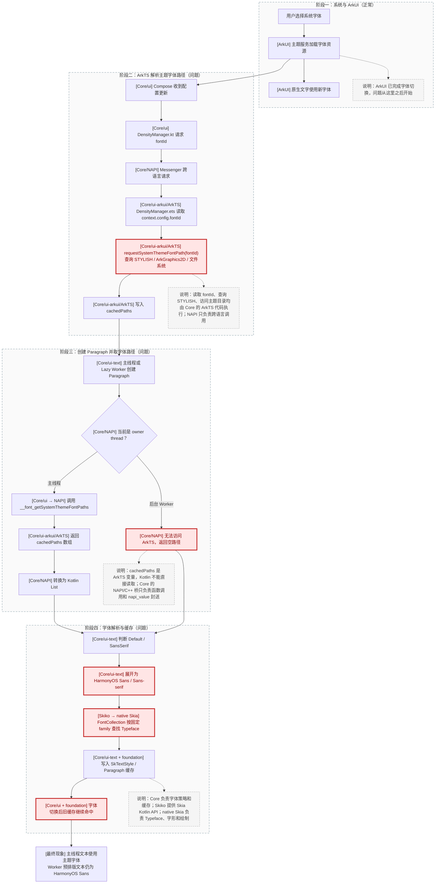

各层和执行主体如下：

| 所属层/仓库 | 在本问题中的职责 | 不负责什么 | 关键位置 |
| --- | --- | --- | --- |
| ArkUI / Core `ui-arkui` 的 ArkTS | 读取 `Configuration.fontId`、读取主题目录和 `manifest.json`、调用 ArkGraphics2D、维护 `cachedPaths` | 不负责 Compose 缓存键和 Skia FontCollection | `compose-multiplatform-core/compose/ui/ui-arkui/.../ets` |
| Core 的 NAPI/Messenger 桥 | 在 ArkTS 与 Kotlin/Native 之间调用函数并封送 `napi_value` | 不解析字体文件，也不选择字体 | `compose/ui/ui/.../napi`、`compose/ui/ui-arkui/.../cpp` |
| Compose Core（Kotlin/Native） | 创建 Paragraph、决定 Compose `fontFamily`、维护文本缓存、检测字体身份变化、选择渲染后端 | 不直接读取 ArkTS 模块变量 | `compose/ui/ui`、`ui-text`、`foundation/foundation` |
| Skiko | 提供 Kotlin/Native 的 Skia API 和原生桥接，例如 `FontMgr`、`Typeface`、`FontCollection`、`Canvas`、`Paragraph`、`DirectContext` 和 OHOS KLIB | 不决定 Compose 字体语义或后端选择 | `third_party/skiko/skiko/skiko` |
| Native Skia | 执行字体文件解析、字形 shaping、断行、文本布局和像素绘制 | 不知道 ArkTS `cachedPaths`，路径必须由 Core 经 Skiko 传入 | Skiko 链接的原生 Skia/静态库 |
| Fusion 原生层 | 实现 OHRender RenderNode、OH_Drawing Canvas、文本、编解码和 ArkUI RenderNode 行为 | 不负责 Compose 后端选择 | `third_party/fusion-render/OHRender` |

关键边界：

- `compose/ui/ui-text/src/skikoMain/` 是 **Compose Core 的 Skiko 目标源集**，不是 Skiko 仓库代码。
- `FontFamily.Default -> SansSerif -> aliases` 的策略由 Core 决定。
- Skiko 提供 `FontMgr`、`FontCollection`、`Typeface` 等 Kotlin API，并把调用转给 native Skia。
- Fusion 模式下，Core 选择后端；Skiko 提供 Fusion bridge；RenderNode/OHRender 内部行为归 `fusion-render`。
- 因此不能把整条链路简单分成“ArkTS 做前半段、C++ 做后半段”。跨层时通过 NAPI、Messenger、Skiko API 或后端接口传递数据。

图中需要重点理解的事实：

1. 读取 `Configuration.fontId` 的是 ArkTS `DensityManager.ets`，不是 C++ 或 Skia。
2. `cachedPaths` 属于 ArkTS；Kotlin 只能通过 NAPI 调用 `__font_getSystemThemeFontPaths` 取得数组副本。
3. 不同 Text 的 Paragraph 可能在主线程或 Lazy Worker 创建。Worker 无法通过 NAPI 读取 ArkTS 数据，因此得到空路径。
4. 页面刷新不等于字体缓存失效；即使重新绘制，仍可能复用旧 Paragraph 和旧 Typeface。

## 3. 修复前逐阶段分析

### 3.1 ArkUI 已经应用主题字体（正常阶段）

这一阶段平台侧工作正常：

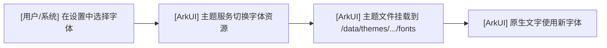

这一阶段没有 Compose Core、Skiko 或 Skia 的字体选择逻辑参与；它们要等到 Compose 创建 Paragraph 时才读取字体。

问题不在 ArkUI，而在于 Compose 后续无法稳定得到 ArkUI 当前实际加载的字体文件路径。具体有两类失败：

```text
主线程路径：
fontId
  -> 查询 STYLISH
  -> 可能取到错误字体，也可能取不到当前主题字体

后台 Worker 路径：
调用 NAPI 查询字体
  -> 不是 NAPI owner thread
  -> 返回空路径
```

因此“没有可靠取得”不是指 ArkUI 没有切换字体，而是指 Compose 无法稳定得到“当前实际使用的是哪个字体文件”这一结果。

### 3.2 字体定位阶段（问题阶段）

这一阶段的目标是：

```text
Configuration.fontId
  -> 当前实际主题字体
  -> 主字体文件路径
  -> 回退字体文件路径
```

但旧逻辑没有可靠的 `fontId -> 字体文件路径` 映射，因此尝试从 `STYLISH` 分类中选择候选：

#### Core 怎样取得 `fontId`

Kotlin/Native 侧由 Core 的 `DensityManager.kt` 通过 Messenger 请求字体身份：

```kotlin
fun getFontId(): String {
    cachedFontId?.let { return it }
    val fontId = messenger.send(SEND_GET_FONT_ID).orEmpty()
    cachedFontId = fontId
    return fontId
}
```

对应的 ArkTS 实现读取 `context.config.fontId`，并启动主题字体路径解析：

```typescript
const contextFontId = (context.config as ConfigurationWithWeight).fontId
if (contextFontId !== undefined && contextFontId !== null && contextFontId.length > 0) {
  requestSystemThemeFontPath(contextFontId)
  return getSystemThemeFontIdentity(contextFontId)
}
```

这里 `context.config.fontId` 由 ArkTS 读取；Kotlin/Native 只是跨层发起请求。

#### 修复前怎样查询 `STYLISH`

下面的“修复前等价逻辑”来自修复前 Resolver：

```typescript
const stylishNames =
  await text.getSystemFontFullNamesByType(
    text.SystemFontType.STYLISH
  )

const fullNames = stylishNames.length > 0
  ? stylishNames
  : await text.getSystemFontFullNamesByType(
      text.SystemFontType.GENERIC
    )

let selectedPath = ''
for (const fullName of fullNames.slice(0, 16)) {
  const descriptor = await text.getFontDescriptorByFullName(
    fullName,
    stylishNames.length > 0
      ? text.SystemFontType.STYLISH
      : text.SystemFontType.GENERIC,
  )
  const path = descriptor.path ?? ''
  if (selectedPath.length === 0 && path.length > 0) {
    selectedPath = path
  }
}

cachedPath = selectedPath
```

逐步解释：

1. ArkTS 调用 `getSystemFontFullNamesByType(STYLISH)`，取得系统归类为“风格字体”的字体名称列表。
2. 只要列表非空，就把全部 `STYLISH` 名称当成当前主题候选。
3. 列表为空时，才退回 `GENERIC`。
4. 最多遍历前 16 个名称，调用 `getFontDescriptorByFullName` 查询每个字体的 descriptor。
5. 取第一个 `descriptor.path` 非空的文件路径。
6. 将这个单一路径写入 `cachedPath`。

失败点在于第 2、5 步：

- `STYLISH` 列表表示“存在哪些风格字体”，不表示“当前主题选择了哪一个”。
- 第一个有路径的字体不一定是 ArkUI 正在使用的主题字体。
- 如果列表为空或 descriptor 没有可读路径，最终就是空路径。

旧 Resolver 的异步请求逻辑还会在开始解析时先清空缓存：

```typescript
export function requestSystemThemeFontPath(fontId: string): void {
  if (
    fontId.length === 0 ||
    pendingFontId === fontId ||
    resolvedFontId === fontId
  ) {
    return
  }

  cachedPath = ''
  pendingFontId = fontId
  resolveSystemThemeFontPath(fontId)
}
```

因此解析进行期间，`cachedPath` 暂时为空；Paragraph 如果此时读取，就只能回退 HarmonyOS Sans。

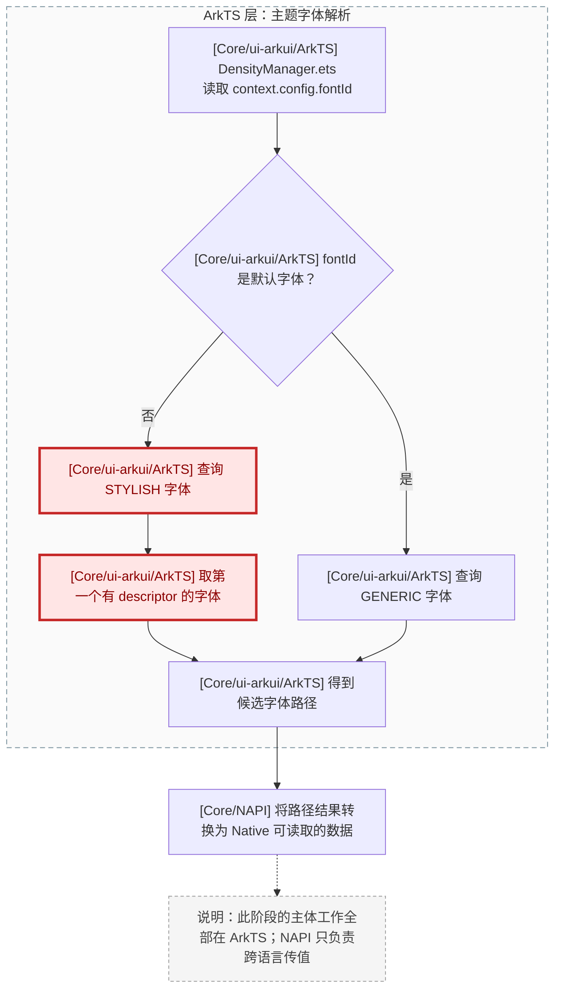

问题原因：

- `fontId` 是系统字体选择的不透明标识，不是字体名称，也不是文件路径。
- `STYLISH` 表示 2-in-1 设备的风格字体，不代表用户安装字体的完整集合。
- `STYLISH` 更不代表用户当前选中的主题字体。
- `INSTALLED` 能列出部分用户安装字体，但列表本身不能说明当前主题选中了哪一个。
- `ALL` 也只是一份“系统中存在哪些字体”的列表，不能表示“当前选择”。

旧代码路径：

```text
[Core/ui] DensityManager.kt
  -> [Core/NAPI] Messenger 请求 compose.ui:Density.getFontId
  -> [Core/ui-arkui/ArkTS] DensityManager.ets getFontId
  -> [Core/ui-arkui/ArkTS] 读取 context.config.fontId
  -> [Core/ui-arkui/ArkTS] requestSystemThemeFontPath(fontId)
  -> [Core/ui-arkui/ArkTS] resolveSystemThemeFontPath(fontId)
  -> [Core/ui-arkui/ArkTS] 查询 SystemFontType.STYLISH
  -> [Core/ui-arkui/ArkTS] getFontDescriptorByFullName
  -> [Core/ui-arkui/ArkTS] 取第一个可读字体路径
```

相关文件：

```text
compose/ui/ui/src/ohosArm64Main/kotlin/androidx/compose/ui/arkui/density/DensityManager.kt
compose/ui/ui-arkui/src/ohosArm64Main/cpp/compose/src/main/ets/compose/font/OhosSystemThemeFontResolver.ets
```

这一阶段产生的直接问题是：Compose 可能拿到了一个可读字体，但它不一定是当前主题字体。

### 3.3 Paragraph 创建和跨线程字体查询（问题阶段）

#### Paragraph 是什么

`Paragraph` 是 Compose/Skia 完成一次文本排版后的结果对象，不是 HTML 段落标签，也不是普通字符串。

它保存：

```text
文本内容
字体和回退字体
字号、字重、颜色
换行结果
行宽、行高和每行位置
字形和字符位置信息
```

一个 `Text` 在测量时需要生成 Paragraph，父布局才能知道它占多大空间、在哪里换行。

字体解析发生在 Paragraph 创建过程中：

```text
Text 测量
  -> ParagraphIntrinsics
  -> 字体解析
  -> 字形计算和换行
  -> Paragraph
```

#### ArkTS 字体路径如何传给 Kotlin/Skia

ArkTS 和 Kotlin/Native 运行在不同的执行环境中。ArkTS 中的 `cachedPaths` 是 ArkTS 模块内的运行时变量，Kotlin 不能直接按变量名读取它。

正常的主线程链路是：

```text
ArkTS 执行环境（主题字体路径解析）
  -> 解析主题字体文件
  -> 写入 ArkTS cachedPaths

Compose 主线程创建 Paragraph
  -> Kotlin 通过 NAPI 调用 __font_getSystemThemeFontPaths
  -> ArkTS 返回 cachedPaths 的字符串数组
  -> NAPI 将其转换成 Kotlin List<String>
  -> Skia 加载这些字体路径
```

具体过程：

1. ArkTS 解析完成后，将主字体和回退字体路径写入：

   ```typescript
   let cachedPaths: Array<string> = [];
   ```

2. ArkTS 暴露读取函数：

   ```typescript
   export function getSystemThemeFontPaths(): Array<string> {
       return cachedPaths;
   }
   ```

3. ArkTS provider 将读取函数注册为：

   ```typescript
   __font_getSystemThemeFontPaths
   ```

4. Kotlin 通过 NAPI 取得函数对象、调用函数、读取返回数组，并将数组元素转换为 `List<String>`：

   ```text
   OhosNapiTextPlatformProvider.getSystemThemeFontPath
     -> callGlobalArrayFunction("__font_getSystemThemeFontPaths")
     -> JsEnv.getNamedProperty
     -> JsEnv.callFunction
     -> JsEnv.getArrayLength / getElement / getValueStringUtf8
     -> List<String>
   ```

5. Skia 使用这些路径创建 Typeface 并生成 Paragraph。

相关文件：

```text
compose/ui/ui-arkui/src/ohosArm64Main/cpp/compose/src/main/ets/compose/font/OhosSystemThemeFontResolver.ets
compose/ui/ui-arkui/src/ohosArm64Main/cpp/compose/src/main/ets/compose/locale/LocaleProvider.ets
compose/ui/ui/src/ohosArm64Main/kotlin/androidx/compose/ui/text/platform/OhosNapiTextPlatformProvider.kt
compose/ui/ui/src/ohosArm64Main/kotlin/androidx/compose/ui/napi/JsEnv.kt
```

> NAPI 是 ArkTS/JavaScript 与 Native C/C++ 之间的调用接口。这里 Kotlin/Native 通过 NAPI 间接调用 ArkTS 函数，并取得 `cachedPaths` 的字符串数组副本，而不是直接访问 ArkTS 变量。

#### 为什么有主线程和后台 Worker

普通可见文本一般在主线程测量时创建 Paragraph。

Lazy 列表还会提前准备即将显示的 item：

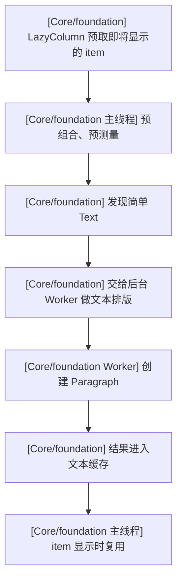

后台 Worker 不修改 Compose LayoutNode 树，也不决定页面元素位置；它只提前完成较重的文本排版计算。

Worker 的实际启动代码（当前代码）是：

```kotlin
private val scope =
    CoroutineScope(SupervisorJob() + textPrefetchWorkerCoroutineContext())

trace("compose:text:prefetch:batch:launch_worker") {
    scope.launch(CoroutineName("prefetch-text-layout-batch")) {
        for (index in keys.indices) {
            nodesToPrefetch[index].prefetchLayout(
                keys[index],
                constraints,
                density,
                layoutDirection,
            )
        }
    }
}
```

OHOS 上 `textPrefetchWorkerCoroutineContext()` 使用：

```kotlin
Dispatchers.Default + Qos.FFRT_QOS_USER_INTERACTIVE
```

这正是 Paragraph 可能不在主线程创建的原因。

#### 修复前的线程分叉

两条路径都会调用字体查询接口：

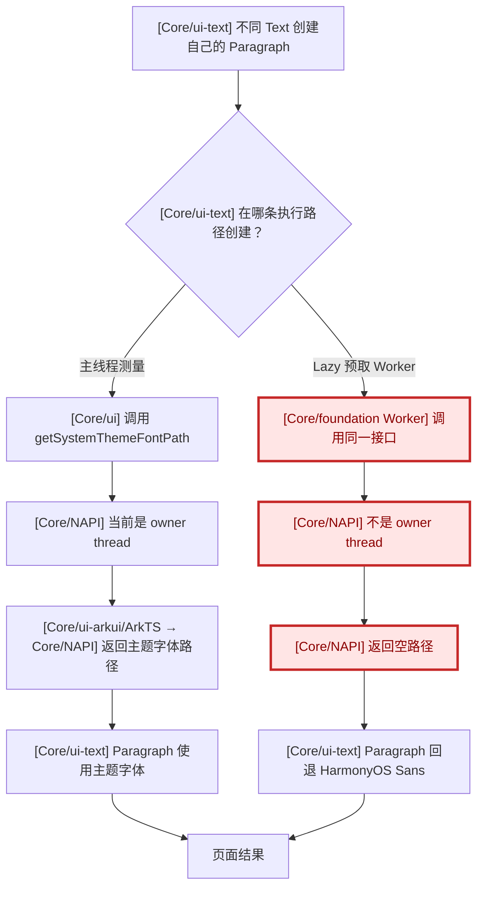

修复前 NAPI 读取逻辑等价于：

```kotlin
override fun getSystemThemeFontPath(): String {
    if (!JsEnv.isOnNapiOwnerThread()) return ""

    return callGlobalArrayFunction("__font_getSystemThemeFontPaths")
        .joinToString("\n")
}
```

它在进入 `callGlobalArrayFunction()` 之前就拒绝后台线程，因此 Worker 没有机会获得 ArkTS 的 `cachedPaths`。

主线程和 Worker 的代码路径：

```text
主线程：
ArkUIViewController.dispatchFrame
  -> ChoreographerManager.onVsync
  -> BaseComposeScene.render
  -> recomposer.performScheduledRecomposerTasks
  -> measureAndLayout
  -> Text measure
  -> ParagraphIntrinsics / Paragraph

Lazy 预取 Worker：
LazyLayoutPrefetchState.executeRequest
  -> scheduleNextTextPrefetchChunk
  -> TextPrefetchSupport.schedulePrefetchLayoutBatch
  -> scope.launch(Dispatchers.Default + Qos.FFRT_QOS_USER_INTERACTIVE)
  -> createPrefetchedParagraphLayout
  -> ParagraphIntrinsics / Paragraph
```

相关文件：

```text
compose/ui/ui/src/ohosArm64Main/kotlin/androidx/compose/ui/arkui/ArkUIViewController.kt
compose/foundation/foundation/src/commonMain/kotlin/androidx/compose/foundation/lazy/layout/LazyLayoutPrefetchState.kt
compose/foundation/foundation/src/commonMain/kotlin/androidx/compose/foundation/text/modifiers/TextPrefetchSupport.kt
compose/foundation/foundation/src/ohosArm64Main/kotlin/androidx/compose/foundation/text/modifiers/TextPrefetchWorkerContext.ohos.kt
compose/ui/ui/src/ohosArm64Main/kotlin/androidx/compose/ui/text/platform/OhosNapiTextPlatformProvider.kt
```

日志中的不同 TID 对应不同 Paragraph 的创建线程：

```text
主线程 TID 58342: resolved=true
后台线程 TID 58486: resolved=false
```

这里的“部分文本”指不同的 Text/Paragraph 走了不同线程，不是同一段文字只取得了一部分字体。

### 3.4 `Default` 被展开为固定 family（问题阶段）

业务代码没有指定字体时，Compose 使用 `FontFamily.Default`。

首先要区分两个不同对象：

- `FontFamily.Default` 是 **Core 中的 Compose 逻辑字体**。
- `cachedPaths` 是 **ArkTS 中的实际字体文件路径列表**。

`Default` 不是 ArkTS 字体查询的返回值，也不会因为用户切换主题字体而被业务 Text 改成具体字体名称。

完整关系如下：

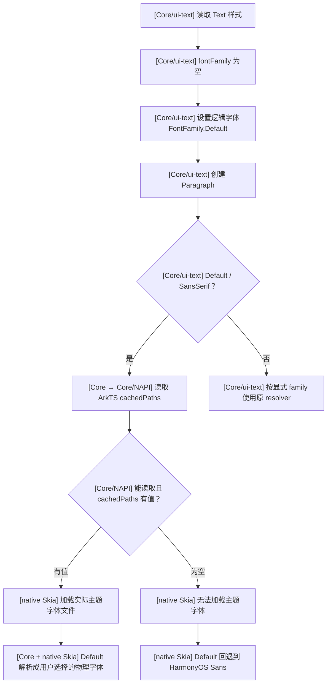

这在业务代码中的表现是：

```text
Text("Compose - Skia")
  -> TextStyle.fontFamily 没有指定
  -> Core 在创建 Paragraph 时使用 FontFamily.Default
  -> Default 是稳定不变的逻辑值
  -> 具体物理字体由 ArkTS 路径、FontCollection 和 resolver 共同决定
```

因此，日志中一直看到 `FontFamily.Default` 并不表示 ArkTS 查询“返回了 Default”。它只表示 Core 收到了“跟随平台默认字体”的样式请求。

旧逻辑的错误分支是：

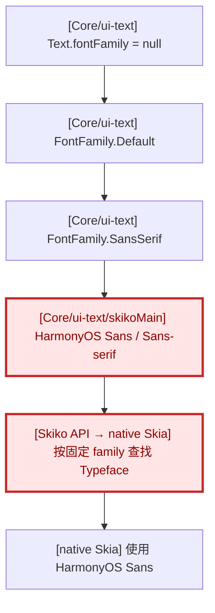

修复前 Kotlin/Core 等价代码如下：

```kotlin
val targetFontFamily = fontFamily ?: FontFamily.Default

val resolved = fontFamilyResolver.resolve(
    targetFontFamily,
    fontWeight ?: FontWeight.Normal,
    fontStyle ?: FontStyle.Normal,
    fontSynthesis ?: FontSynthesis.None,
).value as FontLoadResult

res.fontFamilies = resolved.aliases.toTypedArray()
res.typeface = resolved.typeface
```

`DefaultFontFamily` 在字体解析器中继续被展开为：

```kotlin
is DefaultFontFamily -> FontFamily.SansSerif.aliases
```

OHOS 的 `SansSerif.aliases` 当前是：

```kotlin
listOf("HarmonyOS Sans", "Sans-serif")
```

因此旧代码即使拿到了主题字体路径快照，也没有在 `Default` 解析分支中使用它；实际传给 Skia 的仍是固定 family 名称。

关键调用链：

```text
ParagraphBuilder.toSkTextStyle
  -> targetFontFamily = fontFamily ?: FontFamily.Default
  -> FontFamilyResolver.resolve(Default, ...)
  -> DefaultFontFamily 被映射为 FontFamily.SansSerif
  -> SansSerif aliases = ["HarmonyOS Sans", "Sans-serif"]
  -> Skia 按固定名称查找 Typeface
```

相关文件：

```text
compose/ui/ui-text/src/skikoMain/kotlin/androidx/compose/ui/text/platform/ParagraphBuilder.skiko.kt
compose/ui/ui-text/src/skikoMain/kotlin/androidx/compose/ui/text/platform/PlatformFont.skiko.kt
```

`Default` 原本的语义是“使用平台默认字体”，但展开成具体 family 后，Skia 会把它当作显式字体请求。ArkUI 当前主题字体文件即使已经存在，也不会自动覆盖这个具体 family。

### 3.5 Skia 字体集合缺少主题字体（问题阶段）

SkiaRender 和 Fusion Renderer 对字体的处理方式不同：

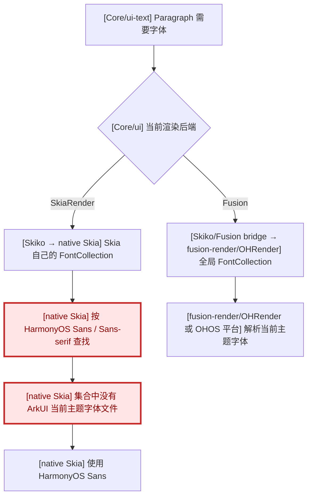

修复前 Skia 路径的关键代码是：

```kotlin
val aliases = ensureRegistered(fontFamily)

if (currentPlatform() == Platform.OHOS) {
    val cached = GlobalTypefaceCache.get(
        aliases,
        interceptedWeight.weight,
        style.slant.ordinal,
    )
    if (cached != null) {
        return cached
    }
}

val typeface = fonts.findTypefaces(
    aliases.toTypedArray(),
    style,
).firstOrNull()
```

其中：

- `ensureRegistered(fontFamily)` 把 `Default` 转成 `HarmonyOS Sans / Sans-serif` alias。
- `GlobalTypefaceCache` 按 alias、字重和倾斜方式查找旧 Typeface。
- `fonts.findTypefaces()` 在 Skia `FontCollection` 中按固定 family 查找。
- ArkTS 返回的主题文件路径没有进入这条分支。

概念说明：

- `FontCollection` 是渲染器维护的“可用字体表”。
- SkiaRender 使用 Skia 自己的字体表。
- Fusion Renderer 使用 OHOS 平台的全局字体表。
- Skia 字体表不会自动包含 ArkUI 当前选择的主题字体，因此必须显式加载主题字体文件。

后端关系：

```text
SkiaRender：
[Core/ui] 选择 SkiaRender 后端
  -> [Core/ui-text] 生成 Compose 文本布局请求
  -> [Skiko API] Canvas / FontMgr / FontCollection / Paragraph
  -> [native Skia] 字体解析、shaping、断行和绘制
  -> XComponent EGL Surface
  -> ArkUI 将整个 Surface 作为一个图层显示

Fusion Renderer：
[Core/ui] 选择 Fusion Renderer 后端
  -> [Core/ui-text] 生成 Compose 文本布局请求
  -> [Skiko/Fusion bridge] RenderNode/Canvas 适配
  -> [fusion-render/OHRender] RenderNode、OH_Drawing Canvas 和文本原生实现
  -> 加入 ArkUI 渲染树
  -> ArkUI RenderService 统一合成
```

对应仓库位置：

```text
Core:
compose-multiplatform-core/compose/ui/ui
compose-multiplatform-core/compose/ui/ui-text
compose-multiplatform-core/compose/foundation/foundation

Skiko:
third_party/skiko/skiko/skiko

Fusion 原生层：
third_party/fusion-render/OHRender
```

在本项目中：

- **自渲染**指 SkiaRender。
- **统一渲染**指 Fusion Renderer。
- Skia 本身没有“切换到统一渲染”的开关；统一或自渲染由 Compose 的 `rendererBackend` 选择。

Fusion 更适合 Compose 与 ArkUI 原生组件深度混排、需要统一 RenderNode 和 ArkUI 渲染能力的页面。SkiaRender 更适合 Compose 为主体、需要完整 Skia 绘制能力和自渲染优化的页面。

### 3.6 字体切换后继续命中旧缓存（问题阶段）

字体文件已经变化，并不代表 Compose 的缓存自动失效：

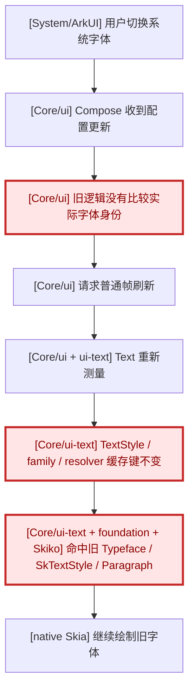

旧逻辑涉及多层缓存：

| 缓存 | 原缓存键 | 字体切换后的问题 |
| --- | --- | --- |
| `GlobalTypefaceCache` | family aliases + weight + slant | family 名称不变，返回旧 Typeface |
| `TypefaceRequestCache` | family + weight + style + loader | resolver 未重建，返回旧 `FontLoadResult` |
| `SkTextStyle` 缓存 | `ComputedStyle` | 键中没有实际字体文件路径 |
| `SkiaParagraphIntrinsicsCache` | 文本 + style + density + resolver | resolver 未变化，返回旧 ParagraphIntrinsics |
| `GlobalMultiParagraphCache` | 文本 + style + constraints + resolver | 继续复用旧 MultiParagraph |

核心缓存键代码（节选）：

```kotlin
internal data class ParagraphIntrinsicsKey(
    val text: String,
    val style: TextStyle,
    val annotations: List<AnnotatedString.Range<out AnnotatedString.Annotation>>,
    val placeholders: List<AnnotatedString.Range<Placeholder>>,
    val densityDpi: Float,
    val densityFontScale: Float,
    val fontFamilyResolver: FontFamily.Resolver,
)

internal data class MultiParagraphCacheKey(
    val text: AnnotatedString,
    val style: TextStyle,
    val placeholders: List<AnnotatedString.Range<Placeholder>>,
    val densityDpi: Float,
    val densityFontScale: Float,
    val constraints: Constraints,
    val maxLines: Int,
    val overflow: TextOverflow,
    val layoutDirection: LayoutDirection,
    val fontFamilyResolver: FontFamily.Resolver,
)
```

修复前 `ComputedStyle` 也没有主题字体路径字段：

```kotlin
private data class ComputedStyle(
    var textForegroundStyle: TextForegroundStyle = TextForegroundStyle.Unspecified,
    var fontSize: Float = Float.NaN,
    var fontFamily: FontFamily? = null,
    // ...
)
```

因此字体文件变化后，这些缓存键仍可能相同。

修复前配置更新也没有比较系统字体身份：

```kotlin
if (densityChanged || fontWeightScaleChanged || localeChanged) {
    fontFamilyResolver = createFontFamilyResolver()
}

if (densityChanged || fontWeightScaleChanged ||
    localeChanged || themeChanged) {
    requestSyncRefresh()
}
```

这里没有 `systemFontIdentityChanged`，所以字体文件变化不会清理文本缓存或重建 resolver。

关键缓存调用链：

```text
ParagraphBuilder.makeSkTextStyle
  -> skTextStylesCache
  -> ComputedStyle.toSkTextStyle
  -> FontFamilyResolver.resolve
  -> TypefaceRequestCache
  -> FontCache.loadPlatformTypes
  -> GlobalTypefaceCache
  -> SkiaParagraphIntrinsicsCache
  -> GlobalMultiParagraphCache
```

相关文件：

```text
compose/ui/ui-text/src/skikoMain/kotlin/androidx/compose/ui/text/platform/ParagraphBuilder.skiko.kt
compose/ui/ui-text/src/commonMain/kotlin/androidx/compose/ui/text/font/FontFamilyResolver.kt
compose/ui/ui-text/src/skikoMain/kotlin/androidx/compose/ui/text/platform/PlatformFont.skiko.kt
compose/ui/ui-text/src/skikoMain/kotlin/androidx/compose/ui/text/platform/SkiaParagraphIntrinsics.skiko.kt
compose/foundation/foundation/src/commonMain/kotlin/androidx/compose/foundation/text/modifiers/MultiParagraphLayoutCache.kt
```

`requestSyncRefresh()` 只请求重新走一帧，不会自动清理这些缓存。因此页面可能重新绘制，但仍然使用旧 Paragraph。

### 3.7 最终混合字体现象

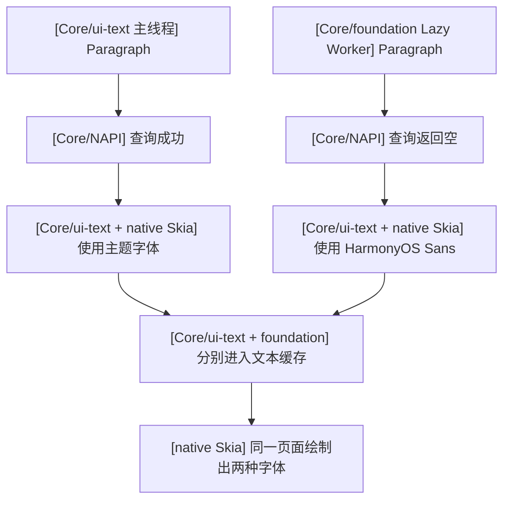

这就是截图中“部分文字切换、部分文字没切换”的完整解释。

## 4. 修复目标与验证

### 4.1 修复目标

```text
字体选择
  -> 解析 ArkUI 当前主题文件
  -> 主线程生成线程安全路径快照
  -> 主线程和 Worker 使用同一快照
  -> Default / SansSerif 使用主题字体策略
  -> SkiaRender 加载具体字体文件
  -> Fusion 使用平台 FontCollection
  -> 字体身份变化时清理全部相关缓存
  -> 重建 resolver 并重新排版
```

### 4.2 字体身份和快照

`fontId` 是当前系统字体配置的不透明标识，不是字体名称、字体 family 或文件路径。Compose 不能从单独的 `fontId` 推断出“这是几分之几手写体”或“文件位于哪个目录”，只能比较其身份。它在本修复中有三个用途：

1. 判断当前是否使用默认字体。
2. 触发当前主题字体文件解析。
3. 与实际字体路径组合成字体身份。

最终身份：

```text
fontId | primaryPath | fallbackPath...
```

#### 当前代码：ArkTS 怎样选择路径

当前 Resolver 先读取 ArkUI 已激活的主题资源；只有在没有可读主题文件时，才回退 `STYLISH` / `GENERIC` descriptor：

激活主题目录的检查逻辑：

```typescript
const THEME_FONT_ROOTS = [
  '/data/themes/a/app',
  '/data/themes/b/app',
]

function resolveThemeFontPathsFromRoot(root: string): Array<string> {
  const fontDirectory = `${root}/fonts`
  const paths: Array<string> = []

  if (
    !fs.accessSync(`${root}/flag`) ||
    !fs.accessSync(fontDirectory)
  ) {
    return []
  }

  const manifest = JSON.parse(
    fs.readTextSync(`${fontDirectory}/manifest.json`)
  )

  // 主字体
  appendFontPath(paths, fontDirectory, manifest.ttfFileSrc ?? '')

  // 按顺序添加 fallback
  for (const source of manifest.ttfFileSrcExt ?? []) {
    appendFontPath(paths, fontDirectory, source)
  }
}
```

如果 manifest 缺失或损坏，当前实现会扫描主题字体目录中的 `.ttf`、`.otf`、`.ttc` 文件作为兼容回退。

拿到候选后的分支是：

```typescript
let activeThemeFontPaths: Array<string> = [];
if (fontId !== DEFAULT_FONT_ID) {
  activeThemeFontPaths = resolveActiveThemeFontPaths();
}

const genericNames =
  fontId === DEFAULT_FONT_ID || activeThemeFontPaths.length === 0
    ? await text.getSystemFontFullNamesByType(
        text.SystemFontType.GENERIC
      )
    : [];

const stylishNames =
  fontId === DEFAULT_FONT_ID || activeThemeFontPaths.length > 0
    ? []
    : await text.getSystemFontFullNamesByType(
        text.SystemFontType.STYLISH
      );
```

最终路径选择规则：

```typescript
if (fontId !== defaultFontId && activePaths.length > 0) {
  return activePaths;
}
return normalizePaths(fallbackThemeFontPaths);
```

这意味着：

1. 非默认字体且存在 ArkUI 激活主题文件时，直接使用主题文件。
2. 不查询 `STYLISH` 覆盖激活文件。
3. 没有激活主题文件时，才通过 `STYLISH` 或 `GENERIC` descriptor 生成 fallback。
4. 路径会去重、去空，并去掉 `file://` 前缀，同时保持主字体在前、回退字体在后。

异步请求通过 `pendingFontId` 防止旧结果覆盖新字体：

```typescript
if (pendingFontId !== fontId) {
  return;
}

cachedPaths = selectedPaths;
resolvedFontId = fontId;
pendingFontId = '';
```

例如用户快速从字体 A 切到字体 B：

```text
A 解析请求发出
B 解析请求发出，pendingFontId = B
A 的异步结果返回
  -> pendingFontId !== A
  -> 丢弃 A 的结果
```

ArkTS 写入路径后生成组合身份：

```typescript
export function getSystemThemeFontIdentity(fontId: string): string {
  requestSystemThemeFontPath(fontId);
  return cachedPaths.length > 0
    ? `${fontId}|${cachedPaths.join('|')}`
    : fontId;
}
```

#### 当前代码：Kotlin 侧路径快照

主线程取得字体路径后保存为线程安全快照：

```kotlin
cachedSystemThemeFontPath
```

核心读取逻辑：

```kotlin
synchronized(lock) {
    cachedSystemThemeFontPath?.let { return it }
}

if (!JsEnv.isOnNapiOwnerThread()) return ""

val path = callGlobalArrayFunction("__font_getSystemThemeFontPaths")
    .joinToString("\n")

synchronized(lock) {
    cachedSystemThemeFontPath = path
}
return path
```

读取规则：

```text
获取锁
  -> 快照不为 null：任意线程直接返回
  -> 快照为 null 且当前是主线程：调用 NAPI，生成并保存快照
  -> 快照为 null 且当前是后台 Worker：不调用 NAPI，暂用平台默认字体
```

这里要区分：

```text
null = 还没有查询过
""   = 已经查询过，但当前没有主题字体路径
```

### 4.3 修复后的 `Default` 和 Skia 字体加载

当前代码只允许 `Default` 和 `SansSerif` 跟随系统主题：

```kotlin
internal fun FontFamily.shouldUseSystemThemeFont(
    isOhos: Boolean,
): Boolean {
    if (!isOhos) return false
    return when (this) {
        is DefaultFontFamily -> true
        is GenericFontFamily ->
            name == FontFamily.SansSerif.name
        else -> false
    }
}
```

`ParagraphBuilder` 不再无条件把 `Default` 解析成 `HarmonyOS Sans / Sans-serif`：

```kotlin
val targetFontFamily = fontFamily ?: FontFamily.Default

val useSystemThemeFont =
    targetFontFamily.shouldUseSystemThemeFont(
        isOhos = currentPlatform() == Platform.OHOS
    )

val useResolvedThemeTypeface =
    useSystemThemeFont &&
    !isFusionRenderBackendActive &&
    systemThemeFontPaths.isNotEmpty()

val resolved =
    if (useSystemThemeFont && !useResolvedThemeTypeface) {
        null
    } else {
        fontFamilyResolver.resolve(
            targetFontFamily,
            fontWeight ?: FontWeight.Normal,
            fontStyle ?: FontStyle.Normal,
            fontSynthesis ?: FontSynthesis.None,
        ).value as FontLoadResult
    }
```

当前 `ComputedStyle` 将字体路径纳入相等性判断，因此 `SkTextStyle` 缓存会随字体文件变化：

```kotlin
internal data class ComputedStyle(
    var systemThemeFontPaths: List<String> = emptyList(),
    var textForegroundStyle: TextForegroundStyle =
        TextForegroundStyle.Unspecified,
    var fontSize: Float = Float.NaN,
    var fontFamily: FontFamily? = null,
    // ...
)
```

SkiaRender 当前代码直接按主题路径加载文件：

```kotlin
val themeFontPaths = systemThemeFontPathsFor(fontFamily)

if (themeFontPaths.isNotEmpty()) {
    val cacheAliases = themeFontPaths.map {
        "CMP_OHOS_SYSTEM_THEME_FONT:${it.hashCode()}"
    }

    themeFontPaths.forEachIndexed { index, path ->
        val typeface =
            FontMgr.default.makeFromFile(path)
                ?: return@forEachIndexed
        // 按 manifest 顺序注册主字体和 fallback
    }
}
```

这里的职责是：

- Core 决定是否允许 `Default` / `SansSerif` 跟随主题。
- Core 读取路径快照并构造 Typeface 缓存键。
- Skiko 提供 `FontMgr` 等 Kotlin API。
- native Skia 执行 `makeFromFile()` 和后续字形布局。
- Fusion 不注入具体 Typeface，继续使用平台 `FontCollection`。

### 4.4 缓存清理

检测到字体身份变化后：

```text
ComposeArkUIViewContainer.applyConfigurationUpdateVisuals
  -> systemFontIdentityTracker.update(systemFontId)
  -> TextPlatformLayoutCache.clear()
  -> TextPlatformFontCache.clearGlobalTypefaceCache()
  -> TextPlatformFontCache.clearFontLoadCaches()
  -> fontFamilyResolver = createFontFamilyResolver()
  -> requestSyncRefresh()
```

相关文件：

```text
compose/ui/ui/src/ohosArm64Main/kotlin/androidx/compose/ui/window/ComposeArkUIViewContainer.kt
compose/ui/ui/src/ohosArm64Main/kotlin/androidx/compose/ui/window/SystemFontIdentityTracker.kt
compose/ui/ui-text/src/skikoMain/kotlin/androidx/compose/ui/text/platform/SkiaParagraphIntrinsics.skiko.kt
compose/ui/ui-text/src/skikoMain/kotlin/androidx/compose/ui/text/platform/PlatformFont.skiko.kt
```

当前核心清理代码：

```kotlin
val systemFontIdentityChanged =
    systemFontIdentityTracker.update(systemFontId)

if (systemFontIdentityChanged) {
    TextPlatformLayoutCache.clear()
    TextPlatformFontCache.clearGlobalTypefaceCache()
    TextPlatformFontCache.clearFontLoadCaches()
}

if (densityChanged || fontWeightScaleChanged ||
    localeChanged || systemFontIdentityChanged) {
    fontFamilyResolver = createFontFamilyResolver()
}

if (densityChanged || fontWeightScaleChanged ||
    localeChanged || themeChanged ||
    systemFontIdentityChanged) {
    requestSyncRefresh()
}
```

这三类清理分别对应：

```text
TextPlatformLayoutCache.clear()
  -> SkiaParagraphIntrinsicsCache
  -> foundation GlobalMultiParagraphCache

TextPlatformFontCache.clearGlobalTypefaceCache()
  -> 旧 Typeface / FontLoadResult

TextPlatformFontCache.clearFontLoadCaches()
  -> 各 FontCache 的 typeface load cache
```

### 4.5 验证结果

```text
buildMode=debug
rendererBackend=skia
device=68Q0223B17000839
stages_ok=true
failed_stage=none
exitCode=0
```

- 冷启动时，主线程和后台 Worker 均取得相同主题字体路径。
- “几分之几手写体”切换到“汉仪粗仿宋”后，首屏、混排区和滚动后新增文本同步更新。
- 切换回原字体后，全部区段同步恢复。
- 不再出现后台 Worker 因线程不匹配产生的 `resolved=false`。

验证证据：

```text
/Users/jinshuo/Desktop/Workspace/CPF_CMP/artifacts/logs/cmp-theme-font-cross-thread/
```

### 4.6 行为边界与限制

跟随系统主题字体：

- `FontFamily.Default`
- `FontFamily.SansSerif`

不跟随系统主题字体：

- `FontFamily.Serif`
- `FontFamily.Monospace`
- `FontFamily.Cursive`
- 自定义 `LoadedFontFamily`
- 显式指定 family 的 `SystemFont`

不属于 Compose 字体链路：

- ArkUI 原生 Button
- ArkUI 原生 Text
- 其它由 ArkUI 自己维护字体的原生组件

主题字体缺少部分字形时回退到系统 CJK 字体是正常行为，不代表 Compose 没有切换字体。

当前限制：

- 默认字体 ID `22200001` 与当前 HarmonyOS 版本有关。
- 主题字体依赖 `/data/themes/{a,b}/app/fonts/manifest.json` 结构。
- 第三方主题缺失或损坏 manifest 时，会扫描 `.ttf`、`.otf`、`.ttc` 文件。
- 字体服务路径属于平台实现细节，升级 HarmonyOS 后需要重新验证。

修复后需要保证的核心不变量：

```text
同一个页面上的所有 Compose 文本
→ 读取同一份字体路径快照
→ 使用同一个字体身份判断缓存是否有效
→ 字体切换后所有相关缓存一起失效
```

## 5. 修复后完整流程图

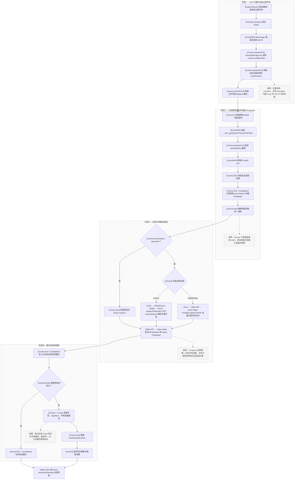
