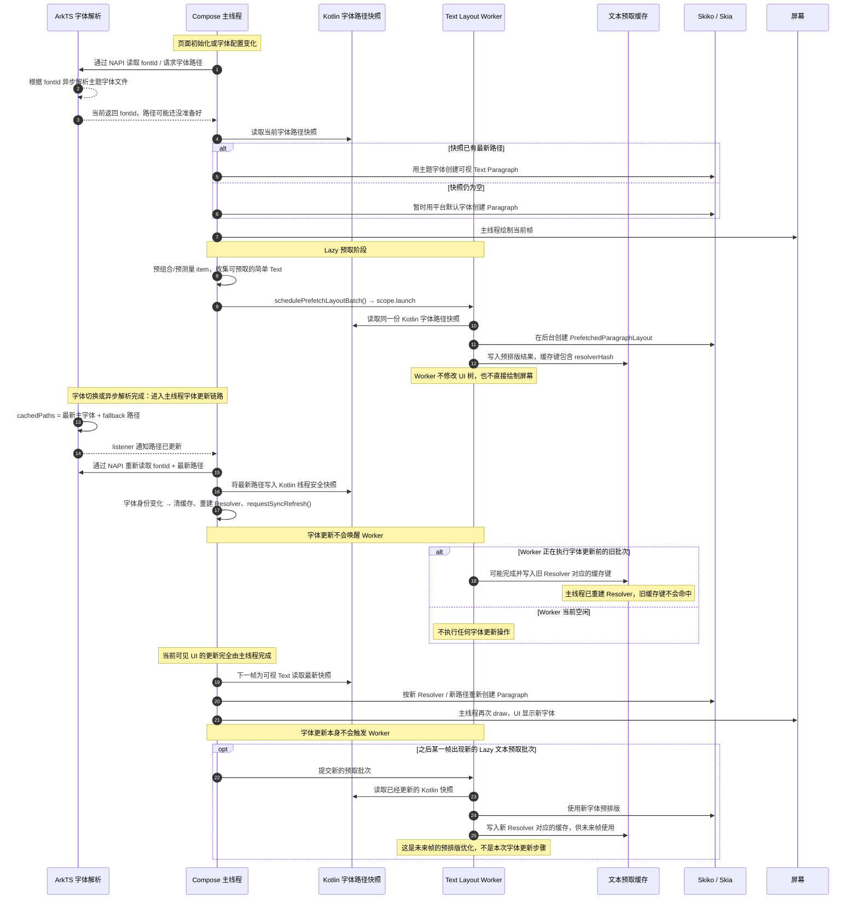

# CMP 主线程、Worker 与主题字体更新

## 一句话结论

主线程负责 UI、NAPI 和最终绘制；Worker 只负责把部分文本提前排版并写入缓存。

字体更新时，主线程把 ArkTS 解析出的最新字体路径写入 Kotlin 快照，然后清理旧缓存、重建 Resolver 并重绘。Worker 不更新 UI，它只在后续任务中读取同一份 Kotlin 快照。

## 完整流程



## 主线程和 Worker 的关系

### 谁创建 Worker

`TextPrefetchSupport` 持有一个进程级 CoroutineScope：

```kotlin
val scope = CoroutineScope(
    SupervisorJob() + textPrefetchWorkerCoroutineContext()
)
```

OHOS 使用：

```kotlin
Dispatchers.Default + Qos.FFRT_QOS_USER_INTERACTIVE
```

主线程收集到待预取 Text 后调用：

```kotlin
scope.launch(CoroutineName("prefetch-text-layout-batch")) {
    // 后台执行 Paragraph 预排版
}
```

因此准确关系是：

```text
主线程提交 Worker 任务
  → Dispatchers.Default 分配后台线程
  → Worker 执行本次预排版批次
  → 结果写入缓存
```

不是每个 Text 创建一条线程，也不是 Worker 自己启动。底层线程可以复用，所以不同批次可能运行在不同 TID 上。

### 谁更新 UI

只有主线程更新 UI：

```text
Worker 预排版
  → 写入 Paragraph 缓存
  → 主线程测量时消费缓存
  → 主线程 layout / draw
  → 屏幕更新
```

Worker 不拥有 Compose LayoutNode 树，也不会直接修改页面。

### Worker 的作用边界

Worker 是 Lazy 文本预取优化，不是通用 UI 排版线程，也不是字体更新的必要步骤。

| 问题 | 实际行为 |
| --- | --- |
| Worker 做什么 | 为可预取的简单 Text 提前创建 Paragraph，并写入预取缓存 |
| Worker 何时运行 | 主线程在 Lazy 预取流程中发现合适文本并提交批次时 |
| Worker 是否更新 UI | 不更新；它不修改 LayoutNode 树，也不调用屏幕绘制 |
| 字体更新是否触发 Worker | 不会直接触发 |
| 字体更新后谁修复可见文本 | 主线程清缓存、重建 Resolver、重新测量并 draw |
| Worker 何时使用新字体 | 后续出现新预取批次时，读取最新 Kotlin 字体路径快照 |

因此，“字体更新后 Worker 没有重新创建 Paragraph”是正常现象。字体更新首先修复当前可见 UI；Worker 只在此后确有新的预取需求时，才使用新字体计算预排版缓存。

### 旧 Worker Paragraph 怎样变成新字体

Paragraph 不会原地修改。字体变化后，旧 Paragraph 被废弃，主线程创建一个新的 Paragraph 替换它。

```text
旧 Worker Paragraph
  → 使用旧 Resolver 和旧字体路径生成
  → 字体身份变化
  → 主线程清文本缓存、重建 Resolver、请求刷新
  → 主线程用新 Resolver 和新字体快照重新测量
  → 创建新的 Paragraph
  → 下一次 draw 使用新 Paragraph
```

预取缓存中的旧结果也不会被新字体直接复用。文本预取缓存的键包含 `resolverHash`，Resolver 变化后：

| 旧 Paragraph 的状态 | 处理方式 |
| --- | --- |
| 已经用于当前可见文本 | 清缓存并重新测量后，被新 Paragraph 替换，旧对象不再被布局引用 |
| 还留在预取缓存中 | 新 Resolver 生成不同的缓存键，因此不会命中；后续由缓存淘汰或 GC 回收 |
| 字体更新时 Worker 仍在生成 | 允许它完成旧任务，但结果写入旧键；不会被新 Resolver 使用 |
| 字体更新后出现新预取批次 | Worker 读取最新快照，用新 Resolver 创建新的 Paragraph 并写入新键 |

所以这里不是“更新 Worker Paragraph”，而是“废弃旧 Paragraph，并按需创建新 Paragraph”。

## 字体更新后怎样拿到最新字体

### 主线程

```text
ArkTS 异步解析主题字体
  → ArkTS cachedPaths 更新
  → 通知 Compose 主线程
  → 主线程通过 NAPI 读取最新 fontId + 路径
  → 写入 Kotlin 字体路径快照
  → 清理旧字体/Paragraph/Typeface 缓存
  → 重建 FontFamilyResolver
  → requestSyncRefresh()
  → 下一帧重新测量并绘制
```

主线程是 NAPI owner thread，所以 ArkTS 字体路径由主线程通过 NAPI 读取。

### Worker

Worker 不能直接调用 ArkTS 的 NAPI，因此它不查 `cachedPaths`。

Worker 只读取主线程已经写入的 Kotlin 线程安全快照：

```text
Worker
  → 读取 Kotlin 字体路径快照
  → 有最新路径：使用主题字体
  → 没有路径：暂时按默认字体排版
```

字体更新以后，后续 Worker 批次会读到新快照。旧 Worker 任务即使还没结束，它生成的结果也会因为 Resolver 变化而不再匹配新的文本缓存键。

如果字体更新后没有新的 Lazy 预取任务，Worker 可以完全不参与这次字体更新。页面仍会由主线程完成重新测量和绘制。

## 为什么可能先看到默认字体

主线程启动 Worker 时只保证：

```text
主线程已经提交任务
```

它不保证：

```text
ArkTS 异步字体路径已经解析完成
```

所以可能出现：

```text
主线程提交 Worker
  → 字体路径尚未完成
  → 主线程或 Worker 先按默认字体创建 Paragraph
  → ArkTS 路径稍后完成
  → 主线程清缓存、换 Resolver、重新排版
  → 最终显示正确主题字体
```

重复工作的范围主要是 Text Paragraph 排版，不是重建整个 Compose UI 树。

## 关键源码

| 作用 | 源码 |
| --- | --- |
| 主线程读取 ArkTS 字体路径 | `compose/ui/ui/src/ohosArm64Main/kotlin/androidx/compose/ui/text/platform/OhosNapiTextPlatformProvider.kt` |
| ArkTS 异步解析主题字体 | `compose/ui/ui-arkui/src/ohosArm64Main/cpp/compose/src/main/ets/compose/font/OhosSystemThemeFontResolver.ets` |
| 字体变化后清缓存和刷新 | `compose/ui/ui/src/ohosArm64Main/kotlin/androidx/compose/ui/window/ComposeArkUIViewContainer.kt` |
| 主线程调度 Worker | `compose/foundation/foundation/src/commonMain/kotlin/androidx/compose/foundation/text/modifiers/TextPrefetchSupport.kt` |
| OHOS Worker Dispatcher | `compose/foundation/foundation/src/ohosArm64Main/kotlin/androidx/compose/foundation/text/modifiers/TextPrefetchWorkerContext.ohos.kt` |

