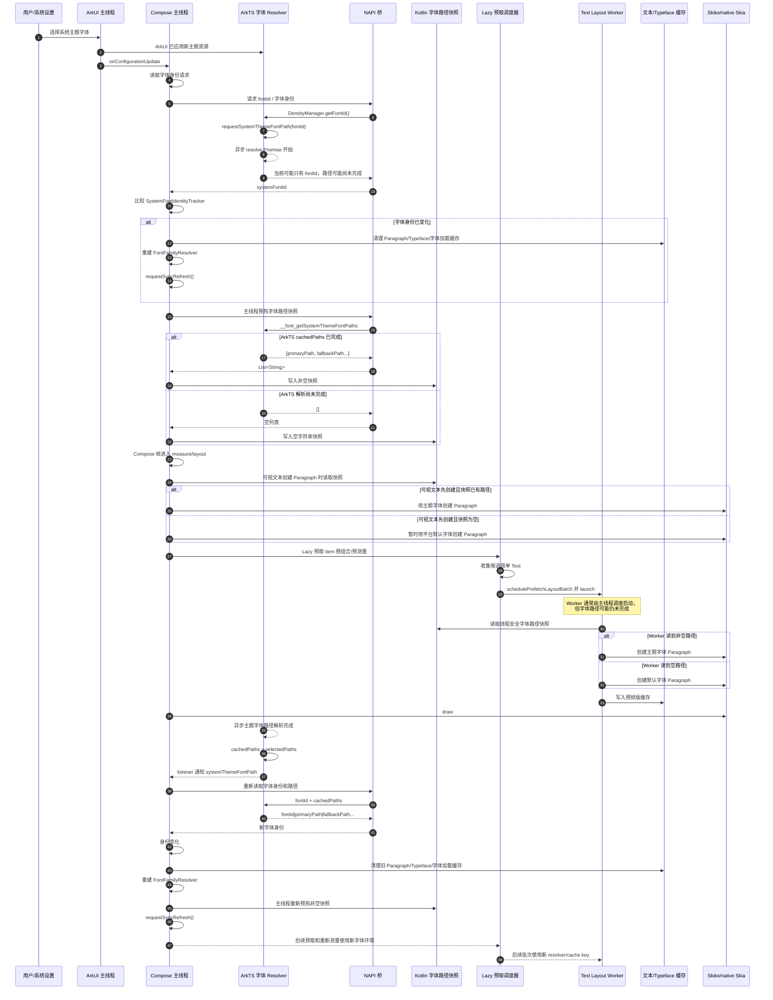
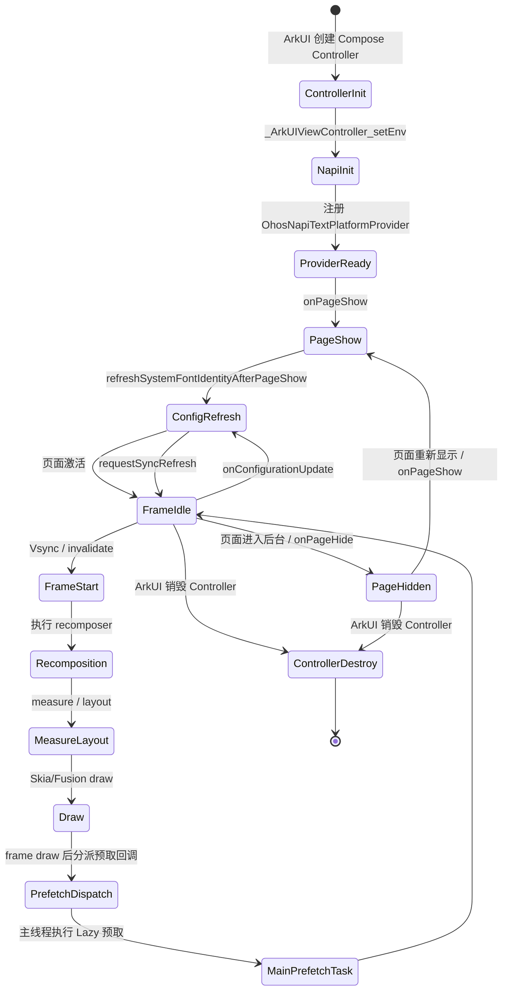
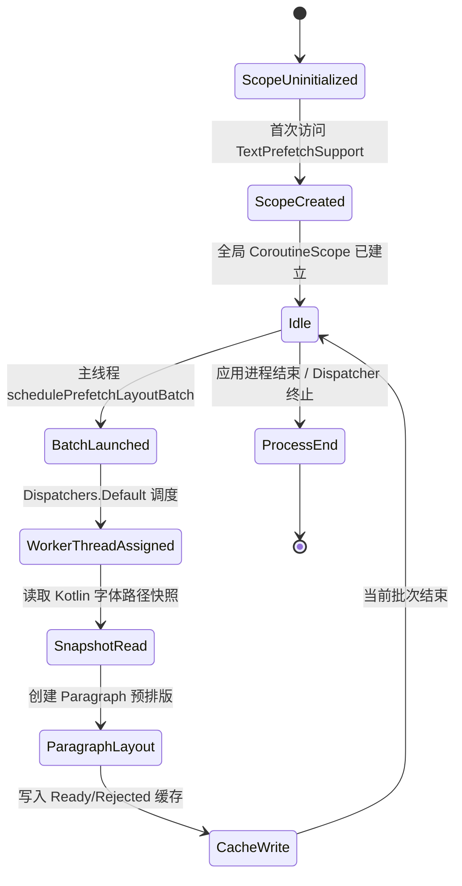
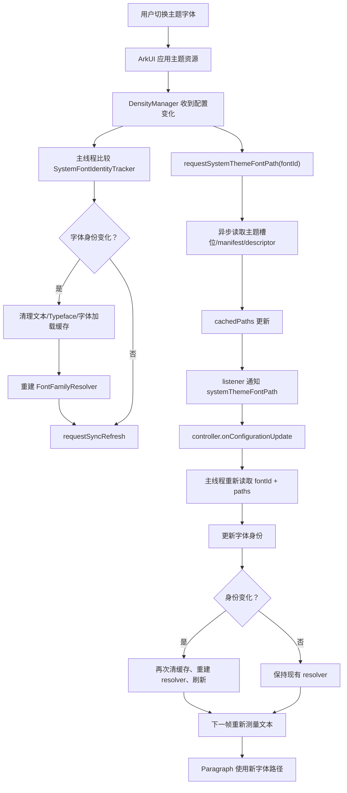

# CMP 主线程、Worker 与系统字体更新流程

> - 分析日期：2026-11-16
> - 当前提交：`cd98e8a3c532fb783e8b6ca796e0c2e73ad547a4`
> - 分析范围：Compose Core 的 OHOS SkiaRender 文本链路
> - 本文只描述当前源码行为，不修改代码

## 1. 先看结论

1. Compose 的 UI 构建、测量、布局和绘制由主线程帧流程驱动。
2. Lazy Worker 不是每个 Text 创建一条线程，也不是 Worker 自己启动的。`TextPrefetchSupport` 持有一个进程级共享的 CoroutineScope；主线程提交批次时调用 `scope.launch`，再由 `Dispatchers.Default` 创建或复用一个后台线程执行协程。
3. 主线程先进入 Lazy 预取流程，收集简单 Text，然后才启动 `prefetch-text-layout-batch` Worker 协程。
4. Worker 只提前生成 Paragraph 排版结果并写缓存，不构建整个 Compose UI 树，也不直接绘制页面。
5. Worker 不能直接调用 ArkTS 的 `__font_getSystemThemeFontPaths`。它只读取 Kotlin 的线程安全字体路径快照。
6. ArkTS 的字体路径解析是异步的。主线程发起了查询，不代表查询已经完成。
7. 因此不存在“主线程一定先拿到非空字体路径，然后 Worker 才开始”的严格保证。Worker 的启动只等待主线程提交批次，不等待 ArkTS 异步路径解析完成。
8. 如果路径在首次 Paragraph 创建前未就绪，主线程或 Worker 都可能先使用默认字体；路径完成后会触发字体身份变化、缓存清理、resolver 重建和重新排版。

## 2. 线程和组件角色

| 角色 | 所属层 | 职责 |
| --- | --- | --- |
| ArkUI 主线程 | HarmonyOS / ArkUI | 由 ArkUI/OHOS 进程创建并持有；驱动 Vsync、页面生命周期、配置回调和 Compose frame |
| Compose 主线程 | Core Kotlin/Native | 组合、测量、创建可视文本 Paragraph、布局、调度预取、绘制 |
| ArkTS 字体 Resolver | Core `ui-arkui` | **异步**解析主题槽位、manifest、ArkGraphics2D descriptor，写入 `cachedPaths` |
| NAPI owner thread | Core NAPI | 调用 ArkTS 函数、转换 `napi_value`；当前通常也是主线程 |
| Kotlin 字体快照 | Core `ui` | 保存主字体和 fallback 路径，供任意排版线程读取 |
| Lazy 预取调度器 | Core foundation | 主线程上的 frame 调度和待预取 item 队列 |
| Text Layout Worker | Core foundation | 只对预取 item 中的简单文本执行后台 Paragraph 预排版 |
| Skiko / native Skia | 字体与排版 | 加载 Typeface、文本 shaping、断行和绘制 |

需要区分两件事：

```text
主线程由 ArkUI/OHOS 创建
Compose 不创建主线程，只是在 ArkUI 主线程上执行 Controller、frame 和配置回调
```

## 3. 完整跨线程时序图



## 4. 主线程生命周期



这张图描述的是 **Compose Controller 在 ArkUI 主线程上的生命周期**，不是操作系统创建主线程的过程。页面销毁后 Controller 生命周期结束，但主线程仍由 ArkUI 继续使用。

### 4.1 主线程首帧之前

```text
ArkUI 创建 Controller
  -> 初始化 NAPI env
  -> 注册 OhosNapiTextPlatformProvider
  -> 注入 systemThemeFontPathProvider
  -> 页面 aboutToAppear/onPageShow
  -> refreshSystemFontIdentityAfterPageShow()
  -> 读取当前 fontId + 路径身份
  -> 必要时清理缓存/重建 resolver
  -> 请求首帧
```

### 4.2 主线程每帧

```text
ArkUI onFrame
  -> ChoreographerManager.onVsync
  -> Compose render
  -> recomposer
  -> measureAndLayout
  -> 可视 Text 创建/复用 Paragraph
  -> draw
  -> draw 完成后分派 prefetch frame callbacks
  -> Lazy 预取在主线程收集任务
  -> 再启动 Text Layout Worker
```

### 4.3 主线程创建 Paragraph

```text
Text measure
  -> ParagraphBuilder.ComputedStyle.set
  -> 读取 Kotlin 字体路径快照
  -> toSkTextStyle
  -> FontFamilyResolver.resolve
  -> PlatformFont/FontCache
  -> Skia 加载 Typeface
  -> 创建 Paragraph
```

如果路径快照已有值，直接使用主题字体。

如果路径快照为空，可能使用平台默认字体，等待路径完成后重排。

## 5. Worker 子线程生命周期

### 5.1 Worker 不是每个 Text 一条线程

`TextPrefetchSupport` 持有全局协程作用域：

```kotlin
private val scope =
    CoroutineScope(
        SupervisorJob() + textPrefetchWorkerCoroutineContext()
    )
```

OHOS 使用的实际 context 是：

```kotlin
Dispatchers.Default + Qos.FFRT_QOS_USER_INTERACTIVE
```

这意味着：

```text
不是每次 Paragraph 都 new Thread
而是每次预取批次 launch 一个 Coroutine
Coroutine 由 Dispatchers.Default 分配线程
底层 OS 线程可能复用
因此不同批次可能看到不同 TID
```

### 5.2 Worker 生命周期图



当前 `TextPrefetchSupport` 没有暴露随单个 Compose Controller 销毁而取消该 scope 的接口。因此 Worker scope 的生命周期是进程级共享的，不等同于某一个页面的生命周期。

### 5.3 Worker 创建和启动时序

```text
主线程 Compose 帧
  -> LazyLayoutPrefetchState.executeRequest
  -> 主线程预组合 item
  -> traversal 收集简单 Text
  -> TextPrefetchSupport.schedulePrefetchLayoutBatch
  -> scope.launch(CoroutineName("prefetch-text-layout-batch"))
  -> Dispatchers.Default 分配 Worker 线程
  -> Worker 执行 Paragraph 排版
```

主线程创建的是 **Coroutine 启动请求**，不是直接手动创建永久 Worker 线程。

`scope.launch` 之后，协程先进入 `Dispatchers.Default` 的调度队列。底层线程可能新建，也可能复用已有线程，所以这里不存在“每条 Text 固定对应一条线程”的关系。

### 5.4 Worker 读取字体路径

Worker 不调用 NAPI：

```text
Worker
  -> getSystemThemeFontPath()
  -> cachedSystemThemeFontPath 快照
```

快照读取受锁保护：

```kotlin
synchronized(lock) {
    cachedSystemThemeFontPath?.let { return it }
}
```

如果快照不存在且当前不是 NAPI owner thread：

```kotlin
if (!JsEnv.isOnNapiOwnerThread()) return ""
```

Worker 不会访问 ArkTS，也不会访问 `napi_value`。

### 5.5 Worker 做和不做什么

Worker 做：

```text
根据共享字体路径快照解析 FontFamily / Typeface
字形计算
断行
Paragraph 预排版
预排版结果缓存
```

Worker 不做：

```text
修改 Compose LayoutNode 树
决定父布局位置
直接绘制页面
直接调用 ArkTS __font_getSystemThemeFontPaths
等待主线程完成 NAPI 查询
```

## 6. 主线程和 Worker 的执行顺序

### 6.1 有明确顺序的部分

```text
主线程进入 Lazy 预取
  -> 主线程预组合/预测量
  -> 主线程提交 Worker 预排版任务
  -> Worker 开始执行
```

Worker 任务的启动依赖主线程调度。

这里的“依赖”只表示主线程必须先提交批次。它不表示字体路径解析已经完成，也不表示快照已经非空。

### 6.2 没有明确顺序的部分

```text
主线程取得非空字体路径
ArkTS 异步字体解析完成
Worker 开始执行
```

这里没有统一屏障，原因是：

```text
主线程可以提交 Worker
  -> 但不会 await ArkTS Promise
  -> Worker 也不会等待“字体路径快照非空”
```

因此能确定的是“Worker 由主线程提交”，不能确定的是“Worker 开始运行时字体路径已经非空”。

可能顺序：

```text
A. ArkTS 路径完成
   -> 主线程写快照
   -> Worker 启动
   -> Worker 使用主题字体
```

也可能：

```text
B. 主线程发起/执行路径查询
   -> ArkTS 路径尚未完成
   -> 主线程或 Worker 先创建 Paragraph
   -> 使用默认字体
   -> ArkTS 稍后完成
   -> 清缓存并重排
```

### 6.3 关键结论

> Worker 通常由主线程创建/调度，但主线程“启动 Worker”不等于主线程“已经拿到非空主题字体路径”。

所以 Worker 完全可能：

```text
在主线程已经读取但结果为空时开始
```

甚至在更复杂的跨帧情况下，也已存在正在执行的旧 Worker 与新的字体配置更新并发。

## 7. 字体路径解析为什么是异步的

主线程只能同步读取 ArkTS 当前缓存：

```typescript
export function getSystemThemeFontPaths(): Array<string> {
  return cachedPaths
}
```

但路径解析本身是 Promise：

```typescript
async function resolveSystemThemeFontPath(
  fontId: string,
): Promise<void>
```

解析内容：

```text
选择 /data/themes/a/app 或 b/app
检查 flag
读取 fonts/manifest.json
解析 ttfFileSrc
解析 ttfFileSrcExt fallback
调用 ArkGraphics2D descriptor
检查路径是否可读
写 cachedPaths
```

因此：

```text
__font_getSystemThemeFontPaths()
  = 同步返回当前缓存

resolveSystemThemeFontPath()
  = 异步填充缓存
```

## 8. 系统字体更新后的完整流程



## 9. 缓存失效时序

字体身份为：

```text
fontId | primaryPath | fallbackPath...
```

例如路径异步完成后，身份可能从：

```text
33300001
```

变成：

```text
33300001|/data/themes/a/app/fonts/theme.ttf|/system/fonts/...ttf
```

此时主线程执行：

```kotlin
if (systemFontIdentityChanged) {
    TextPlatformLayoutCache.clear()
    TextPlatformFontCache.clearGlobalTypefaceCache()
    TextPlatformFontCache.clearFontLoadCaches()
}

if (densityChanged || fontWeightScaleChanged ||
    localeChanged || systemFontIdentityChanged) {
    fontFamilyResolver = createFontFamilyResolver()
}
```

随后：

```text
requestSyncRefresh()
  -> 下一帧重新 measure
  -> Paragraph 缓存使用新 resolver / 新路径键
  -> Skia 加载新 Typeface
```

`TextPrefetchSupport` 的预取缓存键也包含 `resolverHash`。resolver 重建后，旧 Worker 写下的预取结果会因 resolver 不同而不再匹配；旧条目可能暂时留在缓存中等待淘汰，但不会作为新字体环境下的有效结果被使用。

## 10. 冷启动和运行中切换的差异

### 冷启动

```text
ArkUI 页面开始
  -> DensityManager 主动 requestSystemThemeFontPath(initialFontId)
  -> Compose 首帧可能已经开始
  -> 路径完成前可能产生默认字体 Paragraph
  -> 路径完成后通知并重排
```

冷启动存在“路径解析”和“首帧”竞争。

### 运行中切换字体

```text
用户切换字体
  -> ArkUI 应用资源
  -> Compose 收到配置更新
  -> 旧 resolver/缓存可能仍对应旧字体
  -> 异步路径完成
  -> 身份变化
  -> 清缓存并重排
```

运行中切换一般比冷启动更明确，因为已经存在页面和缓存，但仍有异步路径完成窗口。

## 11. 会不会先显示默认字体

有可能，条件是：

```text
首帧文本 Paragraph 创建时
ArkTS cachedPaths 尚未完成
Kotlin 快照为空
```

结果：

```text
Paragraph 使用平台默认字体
```

之后路径完成：

```text
字体身份变化
  -> 缓存失效
  -> resolver 重建
  -> requestSyncRefresh
  -> 下一帧重新排版
```

如果预取文本仍在屏外，通常只会浪费一次预排版计算，用户不一定看到闪烁。

如果文本已经可见，则可能出现一次视觉字体切换或轻微跳动。

## 12. 是否存在严格线程顺序保证

不存在下面的全局保证：

```text
主线程取得非空主题字体
  -> barrier
  -> Worker 才允许创建 Paragraph
```

存在的是以下较弱保证：

```text
Worker 通常由主线程调度
Worker 只读取 Kotlin 快照
路径完成后主线程会触发缓存失效和重新排版
```

因此系统最终会收敛到正确字体，但中间可能有一次缓存更新或重排。

## 13. 性能影响边界

重复工作的范围：

```text
通常是预取文本 Paragraph
不是整个 Compose UI 树
```

可能成本：

```text
Worker 多执行一次 Paragraph 预排版
旧 Paragraph/Typeface 缓存被清理
主线程重新 measure/layout 一次
必要时一次视觉字体跳变
```

不会持续发生：

```text
只在字体路径从“未就绪”变为“已就绪”
或主题字体身份发生变化时发生
```

## 14. 可优化的方向

### 方向一：路径未就绪时暂停文本预取

```text
快照为空
  -> 不启动 Text Layout Worker
  -> 等待路径就绪通知
```

优点：避免无意义的默认字体预排版。

### 方向二：首帧前等待路径

```text
首帧前等待 ArkTS 路径解析
  -> 直接使用正确字体
```

风险：增加首帧等待时间，需要超时和 fallback。

### 方向三：Worker 原生 Resolver

Worker 直接通过 Native 文件系统解析 `/data/themes`。

限制：

```text
依赖平台私有目录和 manifest
可能需要扩展成完整主字体+fallback列表
仍需处理线程共享和字体身份
```

它不能因为“用了 C API”就自动消除重排；只有路径在首次 Paragraph 前就绪并与主线程共享时，才能避免重复排版。

## 15. 源码证据

| 行为 | 源码位置 |
| --- | --- |
| 主线程 NAPI 路径读取 | `compose/ui/ui/src/ohosArm64Main/kotlin/androidx/compose/ui/text/platform/OhosNapiTextPlatformProvider.kt` |
| 字体路径异步解析 | `compose/ui/ui-arkui/.../ets/compose/font/OhosSystemThemeFontResolver.ets` |
| ArkTS 完成通知 Compose | `compose/ui/ui-arkui/.../ets/compose/ComposeMessengerServices.ets` |
| 字体身份检测/缓存清理 | `compose/ui/ui/src/ohosArm64Main/kotlin/androidx/compose/ui/window/ComposeArkUIViewContainer.kt` |
| Worker CoroutineScope | `compose/foundation/foundation/src/commonMain/kotlin/androidx/compose/foundation/text/modifiers/TextPrefetchSupport.kt` |
| Worker Dispatcher/QoS | `compose/foundation/foundation/src/ohosArm64Main/kotlin/androidx/compose/foundation/text/modifiers/TextPrefetchWorkerContext.ohos.kt` |
| Lazy 预取调度 | `compose/foundation/foundation/src/ohosArm64Main/kotlin/androidx/compose/foundation/lazy/layout/SharedPrefetchTaskScheduler.kt` |
| Paragraph 读取路径快照 | `compose/ui/ui-text/src/skikoMain/kotlin/androidx/compose/ui/text/platform/ParagraphBuilder.skiko.kt` |
| Skia 按路径加载 Typeface | `compose/ui/ui-text/src/skikoMain/kotlin/androidx/compose/ui/text/platform/PlatformFont.skiko.kt` |

