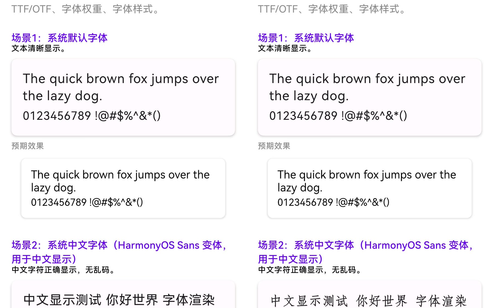

# CMP 跟随系统主题字体 P0 验证报告

| 项目 | 内容 |
| --- | --- |
| 验证日期 | 2026-10-29 |
| 目标 | 验证 Fusion Renderer 下，不指定字体族的 Compose 文本能否由 OHOS 全局主题 FontCollection 选择系统主题字体，并检查显式 `SystemFont("HarmonyOS Sans")` 是否保持固定 |
| 总体结论 | **P0 主假设成立：默认/Material3 文本冷启动后跟随系统主题字体；但显式 `HarmonyOS Sans` 也发生变化，故完整验收为部分通过** |
| 设备 | `68Q0223B17000839`，HarmonyOS 真机 |
| Bundle | `com.tencent.compose` |
| 渲染后端 | `fusion-renderer`；构建日志与启动日志均有明确证据 |
| 源码提交 | `95e04a0240e`，`fix(ui-text): probe OHOS theme font selection` |
| 最终设备状态 | 已恢复预置字体“鸿蒙黑体”，不保留测试字体 |

## 1. 结论

本轮真机验证得到以下结论：

1. `FontFamily.Default` / `FontFamily.SansSerif` 不再写入固定 `fontFamilies` 和 `typeface` 后，Fusion Renderer 的 Compose 文本能够在冷启动时使用系统主题字体。
2. 切换到免费字体“汉仪粗仿宋”（应用后在系统中显示为“汉仪仿宋”）后，首页的默认文本、Material3 文本和大量中文文本均从无衬线字形变为仿宋字形。
3. Fusion 后端不是仅凭界面标题推断。样例标题中的 `Compose - Skia` 是非权威 UI 文案；实际构建和启动证据为：

   ```text
   ComposePlugin: rendererBackend=fusion-renderer
   ComposePlugin: applied fusion-renderer linker options to ohosArm64
   registerFusionRendererStrategies succeed.
   FusionRendererCompose: onAreaChange: 1080 x 2305
   ```

4. 显式 `SystemFont("HarmonyOS Sans")` 的验收失败。切到仿宋后，CustomFont 样例的“场景 2：系统中文字体（HarmonyOS Sans 变体）”也从无衬线变为仿宋字形。
5. 因 P0 未接入 `fontId` generation，本轮只验证冷启动，不宣称支持应用运行中即时切换。

| 验收项 | 结果 | 证据 |
| --- | --- | --- |
| Fusion 冷启动读取当前主题字体 | 通过 | `fontId=h0011`、Fusion 启动日志、切换前后截图 |
| 默认 Compose/Material3 文本跟随主题字体 | 通过 | 首页和 CustomFont 场景 1 前后对照 |
| 显式 `SystemFont("HarmonyOS Sans")` 保持固定 | **失败** | CustomFont 场景 2 前后对照 |
| 运行中热切换 | 未实现、未宣称 | P0 有意未做 generation/cache invalidation |
| SkiaRender 是否支持 | P0 未验证；**P3 已通过** | 见 `CMP系统主题字体-P3-SkiaRender修复与真机验证报告.md` |

因此，P0 已经回答“最关键的底层路径是否可行”：默认字体路径可行。它也暴露出一个新的兼容问题：**主题字体集合可能影响显式命名系统字体的物理字形选择。** 在正式实现前，需要把“显式字体固定”作为独立问题处理，不能直接把本次 P0 当作完整修复。

## 2. 真机验证过程

### 2.1 基线

设备原始主题字体为“鸿蒙黑体”。签名 HAP 安装、拉起后截取基线：

- 首页默认文本为无衬线字形。
- CustomFont 场景 1 使用 `FontFamily.Default`。
- CustomFont 场景 2 使用 `FontFamily(SystemFont("HarmonyOS Sans"))`。

### 2.2 切换系统字体

在系统“字体样式”的在线字体商店中搜索“仿宋”，找到并应用了明确标注“免费”的“汉仪粗仿宋”。没有购买字体、没有开通主题会员。

应用后系统显示“应用成功”和“使用中”。随后通过 OhosDeviceKit 对目标应用执行强制停止和冷启动，启动日志显示：

```text
0#ohos.system.fontId":"h0011"
registerFusionRendererStrategies succeed.
FusionRendererCompose: onAreaChange: 1080 x 2305
```

### 2.3 视觉结果

默认字体路径发生了明确变化。下图为 CustomFont 页面左侧“鸿蒙黑体”基线、右侧“汉仪仿宋”冷启动结果：



可以观察到：

- 场景 1 的 `FontFamily.Default` 文本从默认无衬线字形变为仿宋字形，说明 P0 主路径生效。
- 场景 2 的显式 `SystemFont("HarmonyOS Sans")` 中文字形同样变为仿宋，说明固定字体验收失败。

### 2.4 恢复

测试完成后已切回预置字体“鸿蒙黑体”，系统字体列表显示该项重新选中。设备不保留测试字体作为当前主题字体。

## 3. 源码改动

本轮只包含最小 P0 验证改动，已形成本地提交 `95e04a0240e`，未推送。

### 3.1 修改内容

`compose-multiplatform-core`：

- `compose/ui/ui-text/src/commonMain/kotlin/androidx/compose/ui/text/font/SystemThemeFontPolicy.kt`
  - 仅在 OHOS + Fusion 时，将 `FontFamily.Default` 和 `FontFamily.SansSerif` 视为主题字体候选。
  - `Serif`、`Monospace`、`Cursive` 和非 Fusion 平台保留原行为。
- `compose/ui/ui-text/src/skikoMain/kotlin/androidx/compose/ui/text/platform/ParagraphBuilder.skiko.kt`
  - Theme 候选不写入固定 `fontFamilies` 和 `typeface`，让 OHRender 不调用
    `OH_Drawing_SetTextStyleFontFamilies`。
- `compose/ui/ui-text/src/skikoTest/kotlin/androidx/compose/ui/text/font/SystemThemeFontPolicyTest.kt`
  - 新增策略选择单元测试。

### 3.2 P0 有意未做

- 未读取、保存或比较 `fontId`。
- 未构造字体 generation，也未实现运行中切换。
- 未实现字体环境相关的完整缓存隔离。
- 未完成主题字体的空行、trim、baselineShift、光标等度量适配。
- 未修改 SkiaRender 字体管理器。

## 4. 构建与产物

### 4.1 发布链

Core、Compose Platform 和 Sample 的本地发布均成功：

- Core：`:mpp:publishComposeJbToMavenLocal`，`BUILD SUCCESSFUL`
- Platform：`./scripts/build-ohos.sh`，`BUILD SUCCESSFUL`
- Sample：`publishReleaseBinariesToHarmonyApp -PrendererBackend=fusion-renderer`，`BUILD SUCCESSFUL`

日志：

- `artifacts/logs/cmp-theme-font-p0-core-publish.log`
- `artifacts/logs/cmp-theme-font-p0-platform-publish.log`
- `artifacts/logs/cmp-theme-font-p0-sample-publish.log`

### 4.2 签名 HAP 与安装

使用用户配置的本地签名构建、归档、安装并启动成功：

```text
SignHap: BUILD SUCCESSFUL
install bundle successfully.
start ability successfully.
```

| 产物 | 值 |
| --- | --- |
| signed HAP | `kmp-cmp-test-demo/harmonyApp/entry/build/default/outputs/default/entry-default-signed.hap` |
| 归档 HAP | `kmp-cmp-test-demo/harmonyApp/hap-archives/20261029192219_CMP系统主题字体P0验证-signed_release_D.hap` |
| HAP 大小 | `72,625,976 B` |
| HAP SHA-256 | `72f4ee32f17ac972961f1daa467a18f193850840cd61b4aa84dd23147d1b452a` |
| `libs/arm64-v8a/libkn.so` 大小 | `30,444,632 B` |
| `libs/arm64-v8a/libkn.so` SHA-256 | `8873f730b6679096b2ac28bfe7aefce0050fcda652de4b6da06d14aab12ab724` |
| `libs/x86_64/libkn.so` SHA-256 | `7866266d0c9f1088f17e3b3da6f5abd7a295d6ba01e9f38a55a922153741c3a2` |

安装日志：

`artifacts/logs/cmp-theme-font-p0-hap-signed-install.log`

## 5. 对根因判断的影响

原始分析将问题拆为三层：

1. Compose 把“默认字体”物化为固定 family/typeface。
2. `fontId` 变化没有形成 Compose 字体 generation。
3. Typeface、Paragraph、Intrinsics、MultiParagraph 等缓存缺少字体环境身份。

本轮结果对第 1 层给出了直接验证：

- 跳过固定 `fontFamilies` / `typeface` 后，Fusion 的全局 FontCollection 确实选中了当前系统主题字体。
- 因此“默认字体被固定”是冷启动不跟随的直接原因，该判断成立。

本轮没有证明第 2、3 层已经解决，因为 P0 没有实现它们。运行中切换仍需要：

- 读取并去重 `fontId`。
- 生成新字体 generation。
- 替换字体 Resolver。
- 使文本重新测量和绘制。
- 隔离旧 Resolver、typeface、Paragraph 和异步预取结果。

### 5.1 新发现：显式系统字体被主题字体影响

Compose 策略只在 `Default` / `SansSerif` 时跳过固定字体；`FontFamily(SystemFont("HarmonyOS Sans"))` 仍走原有解析路径。但真机画面显示它仍被主题字体替换。

这说明还需要进一步区分：

- OHRender 的 theme-aware FontCollection 是否把 `HarmonyOS Sans` 也视为可被主题字体替换的别名。
- 传入的具体 typeface 是否没有真正固定物理字体面。
- 主题字体选择发生在 family 解析前还是 typeface 解析后。

当前证据只能确认结果，不能确认上述底层机制。正式实现不能用“CLI 代码分支判断为 false”代替物理字形验收。

## 6. 残余风险

1. **显式系统字体语义。** 需要定义 `SystemFont("HarmonyOS Sans")` 究竟是“固定基础系统字体”还是“跟随主题字体的系统字体族”。当前行为与 P0 预期不一致。
2. **度量一致性。** 本次只检查视觉字形，尚未覆盖固定 `lineHeight`、trim、空行、`baselineShift`、TextField 光标与选区。
3. **运行中切换。** 当前没有 `fontId` generation，不能承诺无需重启即可更新。
4. **缓存隔离。** 冷启动结果不受旧字体环境污染；热切换后旧 typeface/Paragraph 缓存未验证。
5. **后端边界。** P0 只验证 Fusion；SkiaRender 已在 P3 单独实现并完成 `backendId=0` 真机验收。
6. **多语言/富文本。** Emoji、混排 Span、省略、多窗口和后台恢复尚未形成测试矩阵。

## 7. 下一步建议

### 7.1 先做最小原理确认

用原生 OHRender 小样例分别验证：

| 组别 | FontCollection | 样式 | 观察目标 |
| --- | --- | --- | --- |
| A | 全局实例 | 不指定 family/typeface | 是否跟随主题字体 |
| B | 全局实例 | 指定 `HarmonyOS Sans` family | 是否仍被主题字体替换 |
| C | 全局实例 | 指定一个非主题别名的已加载字体 | 是否能固定物理字形 |

这一步用于确定第 5.1 节的新问题，而不是继续在 Compose 层猜测。

### 7.2 再进入 P1

P1 应包含：

- ArkTS 配置桥读取 `fontId`。
- 容器维护字体 generation。
- Default/SansSerif 使用明确 Theme 策略。
- 显式系统字体采用经过真机确认的固定策略。
- Resolver、typeface、Paragraph 和预取缓存按 generation 隔离。
- 记录 `fontId changed -> generation -> resolver -> relayout -> draw` 的可观测链路。

目标行为是：

- Default/SansSerif 冷启动和热切换均跟随主题字体。
- 明确标记为固定的字体不随主题变化。
- 切回默认字体时同样完成更新。
- 字体切换后不出现旧字形、裁切、基线偏移或缓存串用。

## 8. 证据索引

完整证据目录：

`/Users/jinshuo/Desktop/Report/CMP系统主题字体-P0证据`

| 文件 | 内容 |
| --- | --- |
| `before.jpeg` | 原始“鸿蒙黑体”下应用冷启动基线 |
| `system-font-list.jpeg` | 原始预置字体选择 |
| `free-font-detail-ready.jpeg` | 免费“汉仪粗仿宋”详情，应用前 |
| `free-font-after-apply.jpeg` | 系统提示“应用成功/使用中” |
| `after.jpeg` | 仿宋下应用冷启动成功 |
| `customfont-default-font.jpeg` | 默认字体下 CustomFont 页面基线 |
| `customfont-top.jpeg` | 仿宋下 CustomFont 页面 |
| `explicit-font-comparison.jpeg` | 默认与显式系统字体前后对照 |
| `system-font-restore-confirmed.jpeg` | 已恢复“鸿蒙黑体” |

设备启动日志：

`artifacts/logs/cmp-theme-font-p0-device-startup/hilog/hilog.txt`

日志采集清单：

`artifacts/logs/cmp-theme-font-p0-device-startup/manifest.json`

## 9. 最终判断

P0 推荐的底层路径具备可行性：在 Fusion Renderer 中，不设置固定 family/typeface 可以由 OHOS 全局 FontCollection 选中系统主题字体，解决冷启动“默认文本不跟随”的核心问题。

但 P0 还不是完整修复。显式 `SystemFont("HarmonyOS Sans")` 被主题字体影响，说明字体固定语义仍需底层原型确认；`fontId` 热切换、generation 和缓存隔离也尚未实现。建议保留当前 P0 作为方向验证，不直接扩大为正式发布方案。
