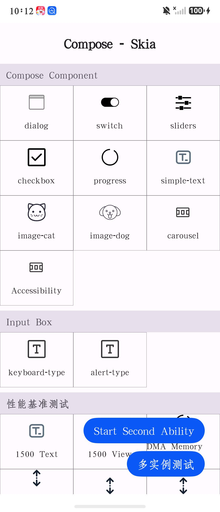
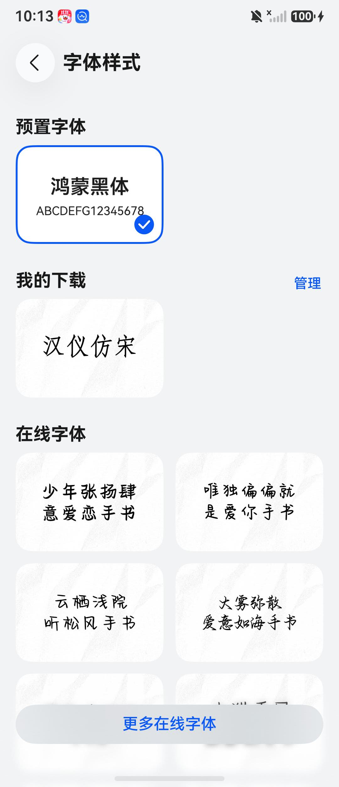
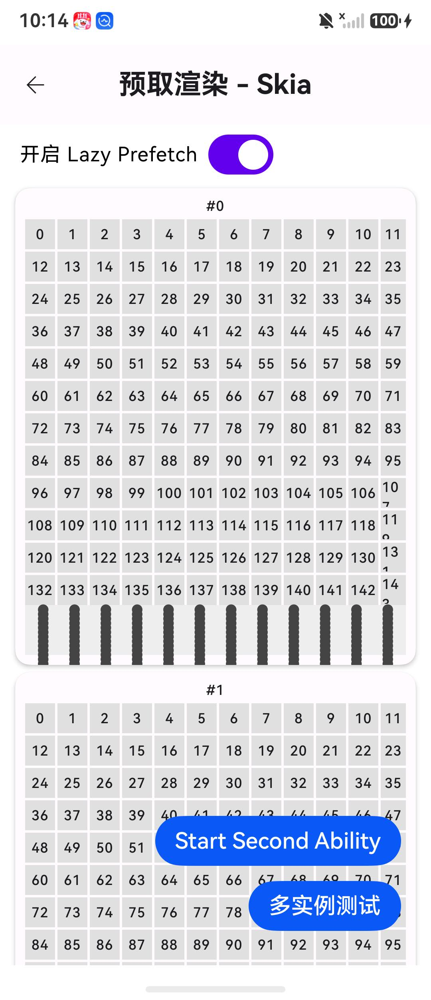

# CMP 跟随系统主题字体 P1 热切换验证报告

| 项目 | 内容 |
| --- | --- |
| 验证日期 | 2026-10-29 |
| 目标 | 验证 Fusion Renderer 下默认 Compose 文本冷启动跟随系统字体，并在应用后台期间切换字体后无需重启 CMP 即可热更新 |
| 总体结论 | **P1 核心路径通过**：Default/SansSerif 冷启动跟随、后台字体切换后同 PID 热刷新均成功 |
| 设备 | `68Q0223B17000839`，HarmonyOS 真机 |
| Bundle | `com.tencent.compose` |
| 渲染后端 | `fusion-renderer` |
| 最终设备字体 | 已恢复原字体“鸿蒙黑体” |
| 源码分支 | `compose-multiplatform-core/develop-1.9.2-OH` |
| 最终源码提交 | `8c30f981f76` |

> **P2/P3 后续状态（2026-10-30）**：本报告的“显式 `SystemFont` 未解决”已由 P2 修复；“SkiaRender 未验证”已由 P3 完成实现和真机双向验证。Skia 在 `backendId=0` 下可跟随默认/自定义主题字体并在同进程热切换。详见 [P2 报告](CMP系统主题字体-P2显式字体与运行修复报告.md) 与 [P3 报告](CMP系统主题字体-P3-SkiaRender修复与真机验证报告.md)。

## 1. 最终结论

本轮完成并验证了系统主题字体问题的 P1 核心修复：

1. `FontFamily.Default` / `FontFamily.SansSerif` 在 OHOS + Fusion 下不再传固定 `fontFamilies` 和 `typeface`，因此可由 OHOS 全局主题 FontCollection 选择系统主题字体。
2. 系统字体为“汉仪仿宋”时，新 HAP 冷启动后的 Compose 首页和 Material3 文本均显示仿宋字形。
3. CMP 进入后台后，在系统设置中把字体从“汉仪仿宋”切回“鸿蒙黑体”，再拉起现有 Ability：

   - CMP PID 前后均为 `23217`。
   - 日志出现：

     ```text
     CMP_FONT, pageShow themeIdentity previous=h0011 current=22200001 generation=1 action=clearFontCaches
     ```

   - 同一“预取渲染”页面标题和文本由仿宋字形更新为无衬线字形。
4. 设备最终恢复原字体“鸿蒙黑体”，测试字体不再作为当前系统字体。

| 验收项 | 结果 | 关键证据 |
| --- | --- | --- |
| Fusion 冷启动跟随当前系统主题字体 | 通过 | 仿宋基线截图、Fusion 构建参数 |
| 后台切换字体后恢复前台热更新 | 通过 | 同 PID `23217`、`fontId h0011 → 22200001`、前后截图 |
| 相同 `fontId` 不重复推进 generation | 源码与测试覆盖 | `SystemFontIdentityTrackerTest` |
| 系统字体恢复原值 | 通过 | 设置页“鸿蒙黑体”选中 |
| 显式 `SystemFont("HarmonyOS Sans")` 保持固定 | P1 时未解决，P2 已修复 | 见 P2 报告 |
| SkiaRender 跟随主题字体 | P1 时未验证；**P3 已通过** | 见 P3 报告 |

## 2. 根因与修复

### 2.1 冷启动根因

Compose 把默认字体解析成固定 `HarmonyOS Sans` / `Sans-serif`，并将具体 family/typeface 写入 OHRender。OHOS 一旦收到显式字体族，就优先使用指定字体，主题字体不会替换它。

修复位于 `ui-text`：

- 仅 OHOS + Fusion 下，`Default` / `SansSerif` 跳过固定 family/typeface。
- Serif、Monospace、业务显式字体、资源字体和 IconFont 保持原路径。

### 2.2 热切换根因

原配置更新链路只传 density 和字号/粗细，没有把 `fontId` 变成字体环境身份。应用在后台被冻结时还可能错过配置回调；恢复前台后即使执行重绘，旧 Resolver 和文本缓存仍可复用。

修复链路：

```text
ArkTS context.config.fontId
  -> DensityManager.getFontId()
  -> SystemFontIdentityTracker
  -> fontId 变化时 generation +1
  -> 清理 typeface / font load / layer snapshot 缓存
  -> 重建 FontFamily.Resolver
  -> requestSyncRefresh()
```

`ComposeArkUIViewContainer.onPageShow()` 会主动重读 `fontId`，不依赖后台配置事件一定送达。

## 3. 源码改动

### 3.1 提交

| 提交 | 内容 |
| --- | --- |
| `95e04a0240e` | P0：Default/SansSerif 使用系统主题字体的最小策略 |
| `ada8834d83e` | P1：字体身份 generation、ArkTS `fontId`、缓存与 Resolver 刷新 |
| `3fa153d3feb` | 页面恢复时主动读取最新字体身份 |
| `66b7e25aceb` | 使用基类配置更新入口安全清缓存 |
| `d5a8fb42406` | `compose.har` 的 API 12 类型兼容 |
| `6f6b87bd0ff` | 避免新版 `window.RotationInfoType` 破坏 API 12 HAR 编译 |
| `8c30f981f76` | 移除未验证的“每次后台恢复无条件重建”兜底，保留已验证的 fontId generation 路径 |

### 3.2 主要文件

- `compose/ui/ui-text/src/commonMain/kotlin/androidx/compose/ui/text/font/SystemThemeFontPolicy.kt`
- `compose/ui/ui-text/src/skikoMain/kotlin/androidx/compose/ui/text/platform/ParagraphBuilder.skiko.kt`
- `compose/ui/ui-arkui/.../density/DensityManager.ets`
- `compose/ui/ui/src/ohosArm64Main/kotlin/androidx/compose/ui/arkui/density/DensityManager.kt`
- `compose/ui/ui/src/ohosArm64Main/kotlin/androidx/compose/ui/window/ComposeArkUIViewContainer.kt`
- `compose/ui/ui/src/ohosArm64Main/kotlin/androidx/compose/ui/window/SystemFontIdentityTracker.kt`
- `compose/ui/ui/src/ohosTest/kotlin/androidx/compose/ui/window/SystemFontIdentityTrackerTest.kt`
- `compose/ui/ui-arkui/.../window/WindowRotationGeometry.ets`
- `compose/ui/ui-arkui/.../compose/ComposeComponentHost.ets`

## 4. 构建与产物

### 4.1 Build-run 结果

最终成功的两个阶段：

| run | 选项 | 内容 | 结果 | 耗时 |
| --- | --- | --- | --- | --- |
| `cmp-font-p1-build-run-E2` | E | 重建 `compose.har`、替换宿主、HAP 构建/签名/归档/安装/拉起 | 成功 | 13 秒 |
| `cmp-font-p1-build-run-C` | C | 重链 Sample `libkn.so`、HAP 构建/安装/拉起 | 成功 | 174 秒 |

两个 run 均为：

```text
[ohos-build-workflow] stages_ok=true failed_stage=none exit=0
```

### 4.2 最终产物身份

| 产物 | 路径 | 大小 | SHA-256 |
| --- | --- | ---: | --- |
| 最终 HAP | `kmp-cmp-test-demo/harmonyApp/hap-archives/20261029221228_CMP系统主题字体P1-UI-Text修复验证_release_C.hap` | `73,033,057 B` | `7d788e06367e280a0748b64ebce16e65f3e83e10f34587844fd87838526dd54c` |
| `arm64-v8a/libkn.so` | `kmp-cmp-test-demo/harmonyApp/entry/libs/arm64-v8a/libkn.so` | `46,900,632 B` | `55c1c78854cbf412492eb64cc050ed172571df0e24c98d09c05a11cfcfaafcf8` |
| `compose.har` | `kmp-cmp-test-demo/harmonyApp/entry/libs/compose.har` | `1,169,535 B` | `a6147a74c1d54f68469e081979181761cd14db65c2ccde5ed47fc471ac9fe5f5` |
| 目标 UI arm64 KLIB | 本地 Maven `ui-ohosarm64:1.9.2-0.5.0-28` | - | `ea1b159c19e0d4d7181281f3e4147ba8941c92d06e9e7625720a4c46c7bcac6d` |
| 目标 UI-Text arm64 KLIB | 本地 Maven `ui-text-ohosarm64:1.9.2-0.5.0-28` | - | `cee4b46162fb45d0aa1df5d043d37e4068c8e78be6f38b7e86b58bbf74e268b3` |

### 4.3 构建链说明

Sample 固定依赖 `1.9.2-0.5.0-28`，而当前 Core 默认发布坐标不同。为完成本机真机验证，本轮将当前 Core 生成的 UI 与 UI-Text arm64 KLIB 以同源码 runtime artifact 方式暂存到 Sample 使用的 0.5.0-28 坐标，并同步本地 Maven `.module` 校验和。该处理属于验证环境对齐，不应直接等价为正式发布方案。

同时修正了两个既有 HAR/API 12 编译阻断：

- 旧 SDK 类型未声明但运行时受 API 版本保护的窗口旋转 API。
- NAPI controller 局部变量缺少显式 ArkTS 类型。

不提升产品兼容 API 版本。

## 5. 真机验证证据

### 5.1 冷启动跟随

系统“汉仪粗仿宋”处于“使用中”时，最终 HAP 冷启动后的 CMP 页面：



页面标题、组件名称和中文文本均为仿宋字形。

### 5.2 系统切回鸿蒙黑体

系统字体详情页点击“应用”后，字体样式页确认“鸿蒙黑体”选中：



### 5.3 同 PID 热更新

恢复 CMP 后，同一“预取渲染”页面由仿宋更新为无衬线：



关键日志：

```text
22:13:59.482 23217 23217 CMP_FONT, pageShow themeIdentity
previous=h0011 current=22200001 generation=1 action=clearFontCaches
22:13:59.482 23217 23217 Index onPageShow
22:13:59.497 23217 23217 FONT DensityManager receive onConfigurationUpdated from ApplicationContext
```

PID 前后均为 `23217`，排除重启后重新读取字体的伪通过。

## 6. 验证检查与构建问题

已执行：

- `git diff --check`
- 内部 `lint-check.js`
- Kotlin OHOS arm64 编译
- `compose.har` ArkTS 编译
- Sample Kotlin/Native 链接
- HAP 签名、归档、安装、拉起
- 真机冷启动、系统字体应用、同 PID 前后台切换、截图和 hilog

内部 `lint-check.js` 未整体通过，但与本轮新增测试无关：

- `ktlint` / `detekt` 命中 `ComposeArkUIViewContainer.kt` 和 `DensityManager.kt` 的大文件既有基线问题。
- `codelinter` 包装脚本指向不存在的 DevEco Studio 5.0.4 Node 路径。

本轮没有运行仓内完整 OHOS test runner；新增 `SystemFontIdentityTrackerTest` 和 `DensityManagerFontIdTest` 已纳入源码，但未单独执行，实际行为以真机结果为准。

## 7. 残余风险

1. **显式系统字体语义未解决。** `SystemFont("HarmonyOS Sans")` 仍被系统主题字体替换，不符合“显式字体固定”的直觉语义。
2. **SkiaRender 已在 P3 验证。** 该后端使用自己的字体集合来源；P3 通过主题字体文件加载、缓存失效和 Resolver 重建完成支持，不能用 Fusion 的无 family 实现直接替代。
3. **缓存范围仍需补强。** 当前已清全局 typeface、font load 和 layer snapshot，并重建 Resolver；完整 MultiParagraph/预取 generation 隔离仍需压力测试。
4. **字体度量未完成矩阵。** 空行、trim、baselineShift、TextField 光标、选区、maxLines/省略和多窗口需要专项验证。
5. **正式版本发布链仍需统一。** 当前 Sample 固定版本与 Core 默认发布版本不一致，本次通过本地构件重暂存完成真机验证；正式交付应统一发布坐标或由消费工程显式对齐版本。
6. **每次后台恢复读取一次 fontId。** 这是同步 messenger 查询，开销较低但尚未形成多窗口/高频前后台切换性能数据。

## 8. 最终判断

P1 核心目标已通过：

> Fusion Renderer 下，默认 Compose/Material3 文本能够冷启动跟随系统主题字体；应用在后台切换系统字体后，恢复前台无需重启，即可通过 `fontId` generation 检测、缓存清理和 Resolver 重建完成热更新。

该结论不能扩展到显式系统字体固定、SkiaRender 或完整复杂文本度量场景。
