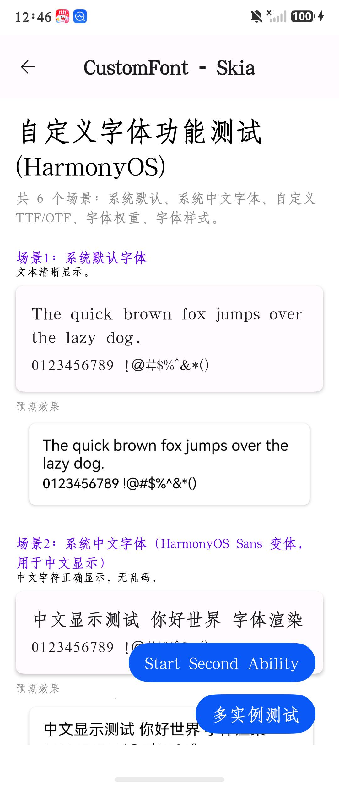
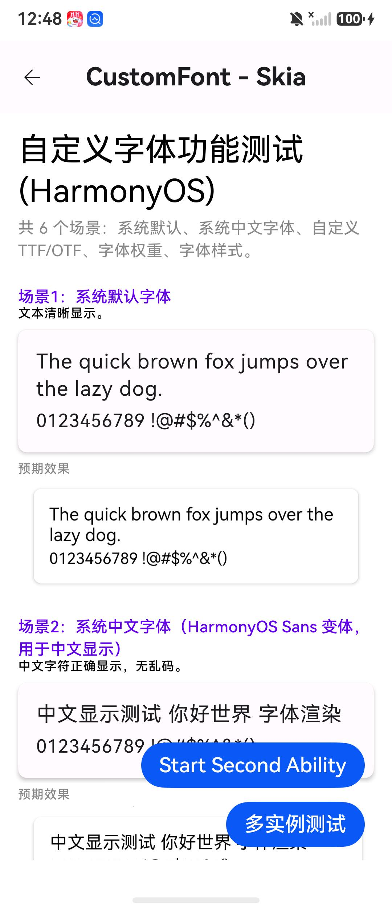
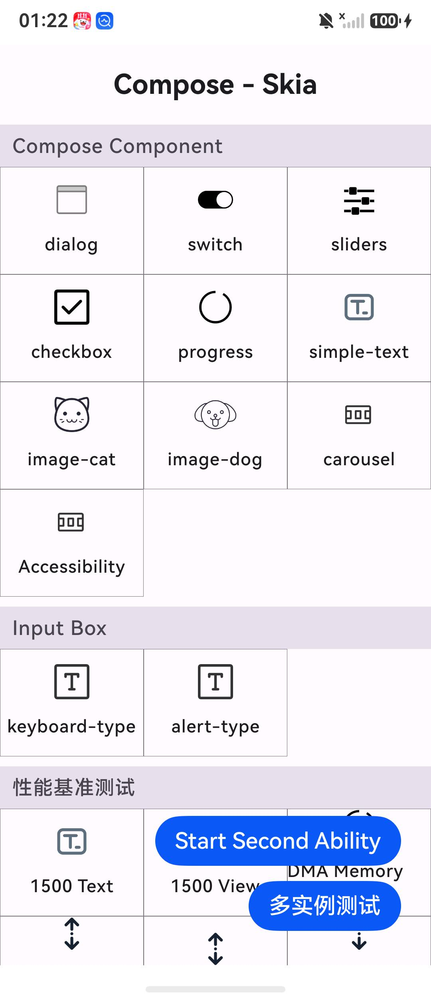
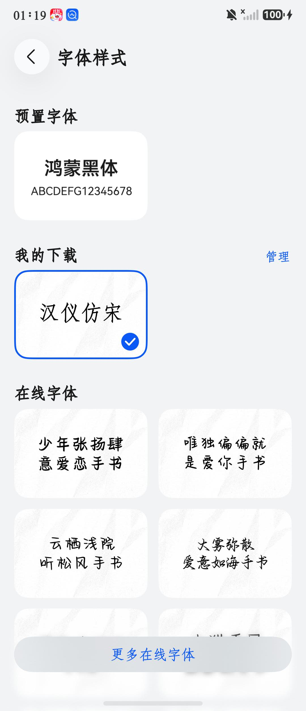
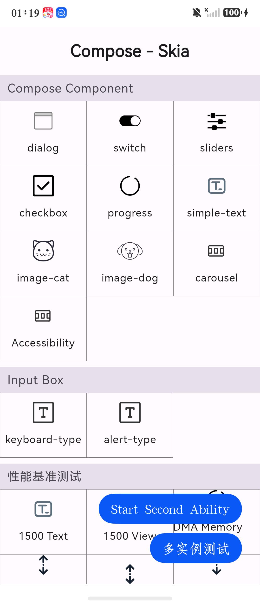
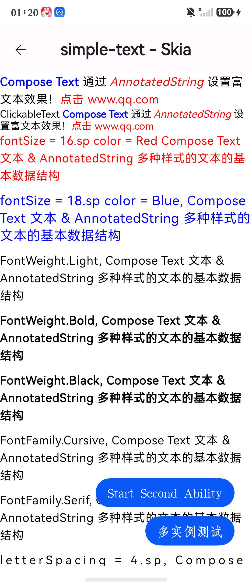
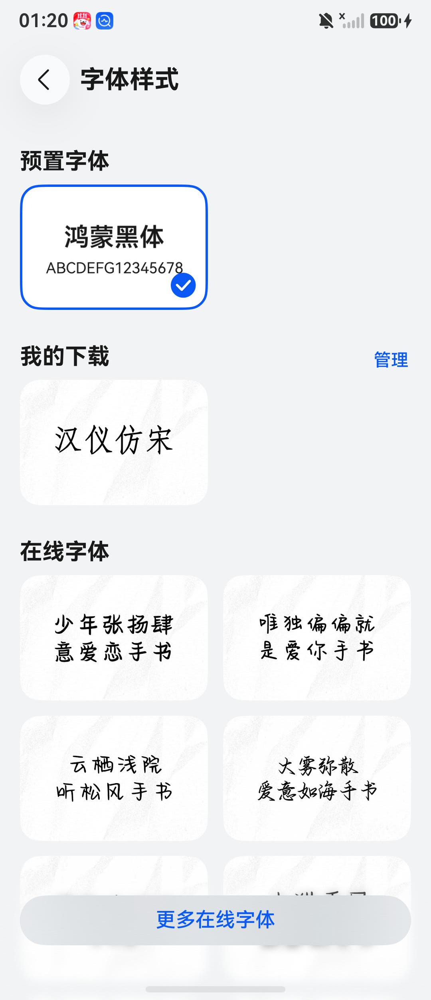
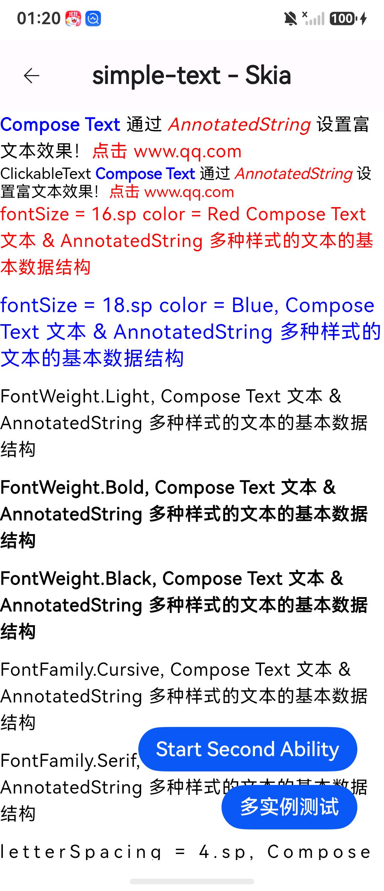

# CMP 系统主题字体 P2：显式字体与运行修复报告

| 项目 | 结论 |
| --- | --- |
| 验证日期 | 2026-10-30 |
| 问题域 | OHOS 系统主题字体、Compose 字体解析、字体缓存失效、HAR/NAPI/C ABI 运行链路 |
| 总体结论 | **Fusion Renderer 主路径通过**：Default/SansSerif 跟随系统主题字体，后台切换后同进程热更新，显式 `SystemFont("HarmonyOS Sans")` 保持固定字体 |
| 历史边界 | P2 当时 SkiaRender 尚未跟随；该项已由 P3 修复并在真实 `backendId=0` 下通过冷启动与热切换验证 |
| 验证设备 | `68Q0223B17000839`，HarmonyOS 真机 |
| 应用 | `com.tencent.compose` / `EntryAbility` |
| 最终设备字体 | “鸿蒙黑体” |
| 最终设备内应用 | 重新安装并运行已通过的 Fusion 最终 HAP，运行日志为 `backendId=1` |
| Core 仓库 | `compose-multiplatform-core`，`develop-1.9.2-OH`，HEAD `be020e0e0ff` |
| Sample 仓库 | `kmp-cmp-test-demo`，HEAD `1ba7d6635` |
| Fusion Renderer 仓库 | HEAD `cc7810c` |
| 验证状态 | Fusion 真机 A/B 通过；Skia 边界已实测，并在 P3 完成修复验收；复杂文本度量矩阵未覆盖 |

## 1. 最终结论

P2 在 P1“默认字体冷启动跟随 + 后台切换热刷新”的基础上，补齐了显式系统字体的语义：

1. `FontFamily.Default` 和 `FontFamily.SansSerif` 在 OHOS + Fusion Renderer 下不写固定 family/typeface，由 OHOS 全局主题 FontCollection 选择当前主题字体。
2. 系统 `fontId` 变化时推进字体 generation、清理字体/图层缓存、重建 `FontFamily.Resolver` 并触发重新排版。
3. 显式 `SystemFont("HarmonyOS Sans")` 在 OHOS 下改用公开系统 family `identity`，不再把内部 `cacheKey` 当作 OHOS 字体族。
4. 最终真机中，系统字体为“汉仪仿宋”时，默认文本显示仿宋；显式 HarmonyOS Sans 文本保持无衬线；恢复“鸿蒙黑体”后默认文本热更新为无衬线，CMP 保持同一 PID。
5. 设备最终已恢复“鸿蒙黑体”，并重新安装 Fusion 最终 HAP；运行日志为 `backendId=1`。

| 验收项 | 结果 | 说明 |
| --- | --- | --- |
| Fusion Default/SansSerif 冷启动跟随主题字体 | 通过 | 系统“汉仪仿宋”下默认文本显示仿宋 |
| Fusion 后台切换字体后热更新 | 通过 | 同一 PID，前后截图与 `CMP_FONT` 日志一致 |
| 显式 `SystemFont("HarmonyOS Sans")` 保持固定 | 通过 | 主题为仿宋时仍显示 HarmonyOS Sans |
| 恢复默认字体 | 通过 | 默认文本恢复无衬线，设备最终为“鸿蒙黑体” |
| SkiaRender 跟随主题字体 | P2 未实现；**P3 已通过** | 见 `CMP系统主题字体-P3-SkiaRender修复与真机验证报告.md` |
| 复杂文本度量完整矩阵 | 未覆盖 | 见第 8 节 |

## 2. 显式 SystemFont 根因与修复

### 2.1 根因

`SystemFont` 同时包含两个名称：

- `identity`：业务或系统公开的 family 名，例如 `HarmonyOS Sans`。
- `cacheKey`：Compose 内部注册/缓存键，用于区分字体对象。

修复前，OHOS 的 `FontCache.load()` 把 `cacheKey` 注册到字体提供者，并作为 `FontLoadResult.aliases` 返回。OHRender 随后把这个内部键写入 OH Typography。OHOS 不认识该内部键时会走全局主题字体回退，结果是显式 `SystemFont("HarmonyOS Sans")` 被当前主题字体替换。

关键调用链：

```text
SystemFont(identity = "HarmonyOS Sans")
  -> FontCache.load(font)
  -> ensureRegistered(typeface, font.cacheKey)
  -> FontLoadResult.aliases = [font.cacheKey]
  -> OHRender 写入无法识别的 family
  -> OHOS 回退到当前主题字体
```

### 2.2 最小修复

修复只改变 OHOS 下 `SystemFont` 的字体族解析：

```kotlin
val useSystemFamilyName = currentPlatform() == Platform.OHOS && font is SystemFont
if (!useSystemFamilyName) {
    ensureRegistered(typeface, font.cacheKey)
}

FontLoadResult(
    typeface,
    listOf(resolvedFontAlias(font, useSystemFamilyName)),
    ...
)
```

其中 `resolvedFontAlias()` 在 OHOS + `SystemFont` 时返回 `font.identity`；其他平台和其他字体仍返回 `font.cacheKey`。字体匹配逻辑同时接受公开 family，避免显式字重和合成路径把它误判成另一字体。

该修复不删除明确定义的字体族，也不改变资源字体、LoadedFontFamily、IconFont、Monospace 等语义。

### 2.3 对应提交

```text
cef517de6d5 fix(ohos): preserve explicit system font family
```

源码：

- [PlatformFont.skiko.kt](/Users/jinshuo/Desktop/Workspace/CPF_CMP/compose-multiplatform-core/compose/ui/ui-text/src/skikoMain/kotlin/androidx/compose/ui/text/platform/PlatformFont.skiko.kt)
- [PlatformFontAliasTest.kt](/Users/jinshuo/Desktop/Workspace/CPF_CMP/compose-multiplatform-core/compose/ui/ui-text/src/skikoTest/kotlin/androidx/compose/ui/text/platform/PlatformFontAliasTest.kt)

## 3. P1 热更新链路

P1 已解决两个前置问题：

1. Default/SansSerif 不再显式写入 `HarmonyOS Sans` / `Sans-serif`。
2. ArkTS 将 `context.config.fontId` 同步到 Kotlin；字体身份变化时推进 generation、清理缓存、重建 Resolver 并重排。

```text
ArkTS context.config.fontId
  -> DensityManager.getFontId()
  -> SystemFontIdentityTracker
  -> fontId 变化：generation + 1
  -> 清理 typeface / font load / layer snapshot 缓存
  -> 重建 FontFamily.Resolver
  -> requestSyncRefresh()
```

`onPageShow()` 会主动重读最新 `fontId`，用于覆盖应用在后台被冻结而错过配置回调的情况。

本轮恢复字体的热切换日志为：

```text
CMP_FONT, pageShow themeIdentity
previous=h0011 current=22200001 generation=1 action=clearFontCaches
```

日志前 PID 为 `4530`，日志后 PID 仍为 `4530`，排除“应用被重建后重新读到字体”的伪通过。

## 4. Fusion 真机 A/B 结果

### 4.1 系统字体为“汉仪仿宋”

默认场景显示仿宋字形：



同一页面中的显式 `SystemFont("HarmonyOS Sans")` 仍保持无衬线：

该截图同时包含默认场景和显式场景，未显示主题字体覆盖显式 family。

### 4.2 恢复“鸿蒙黑体”

系统字体已切回“鸿蒙黑体”：


同一 CMP 进程恢复前台后，默认场景和无衬线场景均显示 HarmonyOS Sans：



### 4.3 最终设备状态

已重新安装 Fusion 最终 HAP 并拉起。运行日志：

```text
render_mode: getRendererBackendId id=1 fnMode=1
```

最终设备首页：



页面标题仍可能显示“Compose - Skia”，这是 Sample 中固定传入的展示文案，不是真实后端身份；后端以运行时 `getRendererBackendId` 为准。

## 5. SkiaRender 验证结果

### 5.1 构建和运行确实切换到 Skia

使用选项 `C`、`release`、`--renderer-backend skia` 重编 Sample 并安装。运行日志：

```text
androidx_compose_ui_arkui_ArkUIViewController_getRendererTypeId id=0
getRenderBackendId id=0 fnMode=1
```

因此本轮 Skia 结果不是由 HAP 标题或其他静态标识误判。

### 5.2 主题字体切换结果

系统字体切换到“汉仪仿宋”：



Skia CMP 冷启动首页：



进入 `simple-text` 后，默认中文仍保持 HarmonyOS Sans 风格，没有显示汉仪仿宋字形：



恢复“鸿蒙黑体”：



同页面对照：



两张 `simple-text` 截图内容区约 1.08% 像素存在阈值差异，但中文 glyph 风格没有从无衬线变为仿宋；该差异不足以证明主题字体选择生效。

### 5.3 Skia 结论

当前策略明确只允许 Fusion：

```kotlin
if (!isOhos || !isFusionRendererActive) return false
```

本节记录的是 P2 当时的历史边界：**SkiaRender 尚未跟随系统主题字体**。该问题已在 P3 单独设计并修复，通过 ArkTS 主题字体文件解析、Skia `makeFromFile`、Skia 文本样式缓存失效和同进程 Resolver 重建完成真机闭环。最新结论以 `CMP系统主题字体-P3-SkiaRender修复与真机验证报告.md` 为准。

## 6. HAR / NAPI / C ABI 配套修复

为得到可运行的最终 HAP，本轮还修复了此前未暴露的包装层问题：

1. `libcompose_arkui_utils.so` 从静态库改为共享库，并作为 NAPI 模块打包。
2. 补齐 rawfile、Kotlin runtime、Skiko bridge 和 Fusion C ABI 的链接。
3. 处理 `libkn.so` 与 HAR 中的 Kotlin runtime 重复打包。
4. 通过真实编译期调用保留 Fusion C ABI 符号，避免 Kotlin/Native DCE 删除。
5. 校验最终包内导出：

   ```text
   androidx_compose_ui_arkui_ArkUIViewController_initFusionRendererNodePreComposed
   androidx_compose_ui_arkui_ArkUIViewController_setFusionRendererRootNode
   ```

相关 Core 提交：

```text
0b260249f45 fix(ohos): package compose ArkUI NAPI module
9b7c2173570 fix(ohos): link rawfile into ArkUI NAPI module
063b46c5808 fix(ohos): resolve z-suffixed rawfile library
149210556e1 fix(ohos): link ArkUI wrapper against Kotlin runtime
21aa1a252db fix(ohos): add Kotlin runtime dependency without repackaging
ec23ab4dc86 fix(ohos): pass Kotlin runtime as linker input
cec486992a8 fix(ohos): link ArkUI wrapper to Skiko bridge
be020e0e0ff fix(ohos): preserve fusion renderer C ABI calls
```

相关 Sample 提交：

```text
f34e914cf fix(harmony): deduplicate packaged Kotlin runtime
0de82c8f4 fix(harmony): retain exported fusion C ABI symbols
1ba7d6635 fix(harmony): use lld undefined-symbol flags
```

说明：`--undefined` 只能辅助链接器保留符号；真正阻止高优化 Kotlin/Native 编译期 DCE 的关键，是 Core 中存在真实调用路径。

## 7. 最终产物与可追溯身份

### 7.1 Fusion 最终 HAP

| 项目 | 值 |
| --- | --- |
| 路径 | `/Users/jinshuo/Desktop/Workspace/CPF_CMP/kmp-cmp-test-demo/harmonyApp/hap-archives/20261030004433_CMP系统主题字体P2-显式SystemFont修复-最终运行_release_D.hap` |
| 大小 | `73,352,737 B` |
| SHA-256 | `d29f2a1bf8e830f34e54039fc55b12ab6a7411d3c6d7862583ddbb2352513c2d` |
| 构建选项 | `D` |
| 构建模式/后端 | `release` / Fusion Renderer |
| 安装拉起 | 成功 |

HAP 内 `libs/arm64-v8a/libkn.so` 已被 Hvigor 剥离调试符号，因此不能直接与未剥离的入口文件比较 SHA-256：

| 产物 | 大小 | SHA-256 |
| --- | ---: | --- |
| HAP 内 `libkn.so` | `30,600,312 B` | `2e82d3061671250419ca8f23a53a93b276cd9c8772e6fcf9ae75f626945dba84` |
| HAP 内 `libcompose_arkui_utils.so` | `143,520 B` | `822d5baf395a098580efa699edf939597b89b8ebbe6c75a537b4246f48d296a9` |
| 最终构建输入 `compose.har` | `20,793,002 B` | `c6a7dbe216e3f491411be04f9ecdb0b928697c0eaa42326c8c9ce5294b5a52d6` |

Fusion 最终构建时入口 `entry/libs/arm64-v8a/libkn.so` 的未剥离 SHA-256 为：

```text
319aed61a3db3fc80bcee183188191aed269b37b355d26fd322e7341a97ed0c1
```

后续 Skia 边界验证重新生成了 Sample `libkn.so`，当前工作树中的该文件已不是 Fusion 版本；设备上已重新安装上方归档的 Fusion HAP，因此运行身份以 HAP SHA-256 和包内已剥离 `libkn.so` 为准。

`compose.har` 不会以原文件形式直接出现在 HAP 中，它由 ArkTS 工具链整合；其 SHA-256 用于标识构建输入。

### 7.2 Skia 边界验证 HAP

| 项目 | 值 |
| --- | --- |
| 路径 | `/Users/jinshuo/Desktop/Workspace/CPF_CMP/kmp-cmp-test-demo/harmonyApp/hap-archives/20261030011754_CMP系统主题字体P2-SkiaRender验证_release_C.hap` |
| 大小 | `105,137,738 B` |
| SHA-256 | `50889c298575141bc27d871fdf0e72364595cfa35664a76193d52e595e99a810` |
| HAP 内 `libkn.so` SHA-256 | `803246412365be877003f0d5f51bbc2977cab2746d90f83a210b9d04a7cafaad` |

该 HAP 是边界验证产物，不是最终交付 HAP。

## 8. 构建与检查记录

### 8.1 构建

| 运行 | 选项 | 结果 | 耗时 | 说明 |
| --- | --- | --- | ---: | --- |
| `cmp-font-p2-sample-local-v2` | Sample 本地构件刷新 | 成功 | 10m21s | 将 Core UI/UI-Text 验证构件对齐到 Sample 本地坐标 |
| `cmp-font-p2-build-AA-v3` | `AA` | 成功 | 见日志 | Core/HAR/Sample 全链路重建 |
| `cmp-font-p2-build-D-final` | `D` | 成功 | 105s | 最终 Fusion HAP 归档、安装、拉起 |
| `cmp-font-p2-build-C-skia` | `C` | 成功 | 787s | Skia Sample 重编、HAP 安装、拉起 |

最终 Fusion 构建机读摘要：

```text
[ohos-build-workflow] stages_ok=true failed_stage=none exit=0
```

日志：

- [p2-sample-local-v2.log](CMP系统主题字体-P2证据/p2-sample-local-v2.log)
- [p2-build-AA-v3.log](CMP系统主题字体-P2证据/p2-build-AA-v3.log)
- [p2-build-D-final.log](CMP系统主题字体-P2证据/p2-build-D-final.log)
- [p2-build-C-skia.log](CMP系统主题字体-P2证据/p2-build-C-skia.log)

### 8.2 收尾检查

- Core `git diff --check`：通过。
- Sample `git diff --check`：通过。
- Core 当前工作树：干净；内部 `lint-check` 因无变更文件而 skipped。
- Sample 当前 `lint-check`：通过 `clang-tidy`，检查文件为生成的 `libkn_api.h`。
- 本轮新增的 `PlatformFontAliasTest`、`SystemFontIdentityTrackerTest` 等单元测试源码已提交，但本轮没有执行完整仓内测试 runner；功能结论以 Fusion 真机结果为主。
- P1 初始化阶段的完整 lint 曾有既有失败：ktlint/detekt 命中大文件基线，codelinter 包装脚本指向不存在的 DevEco 5.0.4 Node 路径。该历史问题不应被写成 P2 新增回归。
- 未 push；未提交签名配置；未写 Git hooks。

## 9. 残余风险与未覆盖范围

1. **Skia 主题字体已在后续 P3 修复。** P2 当时只完成了边界验证；P3 已实现字体文件解析与刷新链路并完成真机验证。
2. **复杂文本度量未做完整矩阵。** 尚未专项覆盖空行、trim、baselineShift、TextField 光标/选区、maxLines/省略、多窗口，以及高频前后台和缓存压力。
3. **API 版本边界。** Fusion 主题字体依赖全局主题 FontCollection；低于支持版本时必须回退旧行为，本轮没有遍历所有 API 版本。
4. **发布坐标仍需统一。** 当前 Sample 使用 `1.9.2-0.5.0-28` 附近本地坐标，Core 默认发布坐标不同；真机验证使用本地构件对齐，正式交付应统一依赖版本和发布流程。
5. **HAR/NAPI/C ABI 修复需按仓库边界提交评审。** 这些修复是运行链必需，但与纯 `ui-text` 字体修复相比影响面更大，应分别纳入兼容性和链接行为审查。
6. **“字体变化”不等于“完整排版正确”。** 当前截图证明字形来源和热刷新；仍需验证 metrics、换行、裁切、光标几何和富文本组合。

## 10. 最终判断

Fusion Renderer 的系统主题字体主路径已达到 P2 目标：

> Default/SansSerif 能跟随系统主题字体；`fontId` 变化可在同一进程内触发缓存清理和重新排版；显式 `SystemFont` 保持固定 family。

P2 的 Skia 限制已由 P3 补齐。Fusion/Skia 结论仍不能替代复杂文本度量、API 版本矩阵和高频生命周期压力测试。

## 11. 证据索引

- [默认字体跟随仿宋](CMP系统主题字体-P2证据/customfont-fixed.jpeg)
- [恢复鸿蒙黑体后的热更新结果](CMP系统主题字体-P2证据/customfont-harmony.jpeg)
- [设备恢复鸿蒙黑体](CMP系统主题字体-P2证据/harmony-applied.jpeg)
- [字体样式页](CMP系统主题字体-P2证据/fontstyle-final.jpeg)
- [最终 Fusion 首页](CMP系统主题字体-P2证据/p2-final-fusion-restored.jpeg)
- [最终 Fusion 运行后端日志](CMP系统主题字体-P2证据/p2-final-fusion-backend-font.log)
- [Skia 运行时后端证据](CMP系统主题字体-P2证据/cmp-skia-runtime-backend.txt)
- [Skia 仿宋环境首页](CMP系统主题字体-P2证据/cmp-skia-serif.jpeg)
- [Skia 仿宋环境 rich text](CMP系统主题字体-P2证据/cmp-skia-simple-text-serif.jpeg)
- [Skia 鸿蒙黑体环境 rich text](CMP系统主题字体-P2证据/cmp-skia-simple-text-harmony.jpeg)
- [Skia 边界构建日志](CMP系统主题字体-P2证据/p2-build-C-skia.log)
- [最终 Fusion HAP 归档清单](CMP系统主题字体-P2证据/20261030004433_CMP系统主题字体P2-显式SystemFont修复-最终运行_release_D.json)
